# ER-диаграммы и реляционные модели по 30 заданиям

Для каждого варианта приведены исходная формулировка, Mermaid-код ER-диаграммы и нормализованная реляционная модель. `PK` — первичный ключ, `FK` — внешний ключ, `UQ` — уникальный атрибут.

## Задание 1. Библиотека

### Текст задания

1. Библиотека Permalink
Информационная система библиотеки, состоящей из двух филиалов, предназначена для учета книг, передаваемых читателям. Каждый филиал библиотеки имеет адрес (улица, дом) и наименование (минимальный набор атрибутов). При записи в библиотеку читатель предоставляет следующую информацию: ФИО, год рождения и адрес. Экземпляры одной и той же книги могут хранится в любом филиале или в обоих филиалах. Минимальный набор атрибутов книги:

наименование;
наименование и адрес издательства;
тип обложки (мягкая, твердая, суперобложка);
год издания;
жанр / тип;
количество страниц.
Простые запросы:

Список книг в библиотеке (наименование, жанр, год издания)
Список филиалов
Список читателей
Сложные запросы:

Читатели, у которых есть книги на руках
Книги у конкретного читателя

### ER-диаграмма

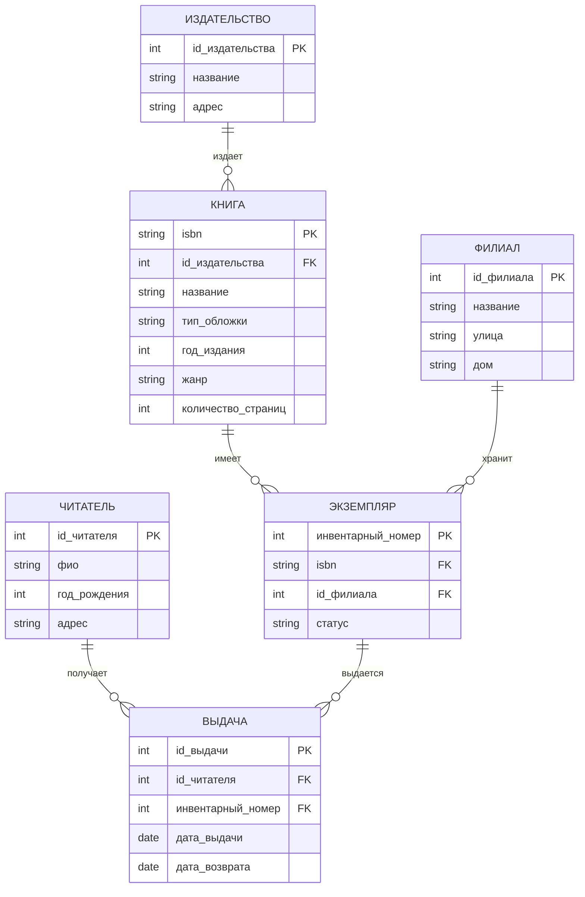

### Реляционная модель

#### ФИЛИАЛ

| Атрибут | Тип | ПК | Обяз. | Уник. | Внешний ключ |
|---|---|:---:|:---:|:---:|---|
| id_филиала | int | + | + | + |  |
| название | string |  | + |  |  |
| улица | string |  | + |  |  |
| дом | string |  | + |  |  |

#### ЧИТАТЕЛЬ

| Атрибут | Тип | ПК | Обяз. | Уник. | Внешний ключ |
|---|---|:---:|:---:|:---:|---|
| id_читателя | int | + | + | + |  |
| фио | string |  | + |  |  |
| год_рождения | int |  | + |  |  |
| адрес | string |  | + |  |  |

#### ИЗДАТЕЛЬСТВО

| Атрибут | Тип | ПК | Обяз. | Уник. | Внешний ключ |
|---|---|:---:|:---:|:---:|---|
| id_издательства | int | + | + | + |  |
| название | string |  | + |  |  |
| адрес | string |  | + |  |  |

#### КНИГА

| Атрибут | Тип | ПК | Обяз. | Уник. | Внешний ключ |
|---|---|:---:|:---:|:---:|---|
| isbn | string | + | + | + |  |
| id_издательства | int |  | + |  | Да |
| название | string |  | + |  |  |
| тип_обложки | string |  | + |  |  |
| год_издания | int |  | + |  |  |
| жанр | string |  | + |  |  |
| количество_страниц | int |  | + |  |  |

#### ЭКЗЕМПЛЯР

| Атрибут | Тип | ПК | Обяз. | Уник. | Внешний ключ |
|---|---|:---:|:---:|:---:|---|
| инвентарный_номер | int | + | + | + |  |
| isbn | string |  | + |  | Да |
| id_филиала | int |  | + |  | Да |
| статус | string |  | + |  |  |

#### ВЫДАЧА

| Атрибут | Тип | ПК | Обяз. | Уник. | Внешний ключ |
|---|---|:---:|:---:|:---:|---|
| id_выдачи | int | + | + | + |  |
| id_читателя | int |  | + |  | Да |
| инвентарный_номер | int |  | + |  | Да |
| дата_выдачи | date |  | + |  |  |
| дата_возврата | date |  | + |  |  |

---

## Задание 2. Аптека

### Текст задания

2. Аптека Permalink
Лекарство
Наименование
Производитель
Поставщик
Тип
Цена (может изменяться)
Возможна ли продажа без рецепта
Покупатель
ФИО
Телефон
Поставщик
Наименование
ИНН
Адрес
Информационная система предназначена для учета движения товаров от поставщиков в несколько филиалов аптечной сети, продажи товаров покупателям.

### ER-диаграмма

```mermaid
erDiagram
    ЛЕКАРСТВО {
        int id_лекарства PK
        string название
        string производитель
        string тип
        decimal цена
        boolean без_рецепта
    }
    ПОСТАВЩИК {
        int id_поставщика PK
        string название
        string инн UQ
        string адрес
    }
    ПОКУПАТЕЛЬ {
        int id_покупателя PK
        string фио
        string телефон
    }
    ФИЛИАЛ {
        int id_филиала PK
        string название
        string адрес
    }
    ПОСТАВКА {
        int id_поставки PK
        int id_поставщика FK
        int id_филиала FK
        date дата
    }
    ПОЗИЦИЯ_ПОСТАВКИ {
        int id_поставки PK, FK
        int id_лекарства PK, FK
        int количество
        decimal цена_закупки
    }
    ПРОДАЖА {
        int id_продажи PK
        int id_покупателя FK
        int id_филиала FK
        date дата
    }
    ПОЗИЦИЯ_ПРОДАЖИ {
        int id_продажи PK, FK
        int id_лекарства PK, FK
        int количество
        decimal цена
    }

    ПОСТАВЩИК ||--o{ ПОСТАВКА : "поставляет"
    ФИЛИАЛ ||--o{ ПОСТАВКА : "получает"
    ПОСТАВКА ||--|{ ПОЗИЦИЯ_ПОСТАВКИ : "содержит"
    ЛЕКАРСТВО ||--o{ ПОЗИЦИЯ_ПОСТАВКИ : "входит"
    ПОКУПАТЕЛЬ ||--o{ ПРОДАЖА : "совершает"
    ФИЛИАЛ ||--o{ ПРОДАЖА : "оформляет"
    ПРОДАЖА ||--|{ ПОЗИЦИЯ_ПРОДАЖИ : "содержит"
    ЛЕКАРСТВО ||--o{ ПОЗИЦИЯ_ПРОДАЖИ : "продается"
```

### Реляционная модель

#### ЛЕКАРСТВО

| Атрибут | Тип | ПК | Обяз. | Уник. | Внешний ключ |
|---|---|:---:|:---:|:---:|---|
| id_лекарства | int | + | + | + |  |
| название | string |  | + |  |  |
| производитель | string |  | + |  |  |
| тип | string |  | + |  |  |
| цена | decimal |  | + |  |  |
| без_рецепта | boolean |  | + |  |  |

#### ПОСТАВЩИК

| Атрибут | Тип | ПК | Обяз. | Уник. | Внешний ключ |
|---|---|:---:|:---:|:---:|---|
| id_поставщика | int | + | + | + |  |
| название | string |  | + |  |  |
| инн | string |  | + | + |  |
| адрес | string |  | + |  |  |

#### ПОКУПАТЕЛЬ

| Атрибут | Тип | ПК | Обяз. | Уник. | Внешний ключ |
|---|---|:---:|:---:|:---:|---|
| id_покупателя | int | + | + | + |  |
| фио | string |  | + |  |  |
| телефон | string |  | + |  |  |

#### ФИЛИАЛ

| Атрибут | Тип | ПК | Обяз. | Уник. | Внешний ключ |
|---|---|:---:|:---:|:---:|---|
| id_филиала | int | + | + | + |  |
| название | string |  | + |  |  |
| адрес | string |  | + |  |  |

#### ПОСТАВКА

| Атрибут | Тип | ПК | Обяз. | Уник. | Внешний ключ |
|---|---|:---:|:---:|:---:|---|
| id_поставки | int | + | + | + |  |
| id_поставщика | int |  | + |  | Да |
| id_филиала | int |  | + |  | Да |
| дата | date |  | + |  |  |

#### ПОЗИЦИЯ_ПОСТАВКИ

| Атрибут | Тип | ПК | Обяз. | Уник. | Внешний ключ |
|---|---|:---:|:---:|:---:|---|
| id_поставки | int | + | + | + | Да |
| id_лекарства | int | + | + | + | Да |
| количество | int |  | + |  |  |
| цена_закупки | decimal |  | + |  |  |

#### ПРОДАЖА

| Атрибут | Тип | ПК | Обяз. | Уник. | Внешний ключ |
|---|---|:---:|:---:|:---:|---|
| id_продажи | int | + | + | + |  |
| id_покупателя | int |  | + |  | Да |
| id_филиала | int |  | + |  | Да |
| дата | date |  | + |  |  |

#### ПОЗИЦИЯ_ПРОДАЖИ

| Атрибут | Тип | ПК | Обяз. | Уник. | Внешний ключ |
|---|---|:---:|:---:|:---:|---|
| id_продажи | int | + | + | + | Да |
| id_лекарства | int | + | + | + | Да |
| количество | int |  | + |  |  |
| цена | decimal |  | + |  |  |

---

## Задание 3. Больница

### Текст задания

3. Больница Permalink
Информационная система больницы (стационара) содержит информацию о врачах больницы и о пациентах. Запись о каждом враче содержит: ФИО, адрес, дату рождения, паспортные данные, специальность, стаж.

Информация о пациенте - ФИО - Дата рождения - Полис - Дата поступления - Дата выписки - Диагноз - Лечащий врач - Отделение - Палата

### ER-диаграмма

```mermaid
erDiagram
    ОТДЕЛЕНИЕ {
        int id_отделения PK
        string название
    }
    ПАЛАТА {
        int id_палаты PK
        int id_отделения FK
        string номер
    }
    ВРАЧ {
        int id_врача PK
        int id_отделения FK
        string фио
        string адрес
        date дата_рождения
        string паспортные_данные UQ
        string специальность
        int стаж
    }
    ПАЦИЕНТ {
        int id_пациента PK
        string фио
        date дата_рождения
        string полис UQ
    }
    ГОСПИТАЛИЗАЦИЯ {
        int id_госпитализации PK
        int id_пациента FK
        int id_врача FK
        int id_палаты FK
        date дата_поступления
        date дата_выписки
        string диагноз
    }

    ОТДЕЛЕНИЕ ||--o{ ПАЛАТА : "содержит"
    ОТДЕЛЕНИЕ ||--o{ ВРАЧ : "включает"
    ПАЛАТА ||--o{ ГОСПИТАЛИЗАЦИЯ : "предоставляется"
    ПАЦИЕНТ ||--o{ ГОСПИТАЛИЗАЦИЯ : "проходит"
    ВРАЧ ||--o{ ГОСПИТАЛИЗАЦИЯ : "лечит"
```

### Реляционная модель

#### ОТДЕЛЕНИЕ

| Атрибут | Тип | ПК | Обяз. | Уник. | Внешний ключ |
|---|---|:---:|:---:|:---:|---|
| id_отделения | int | + | + | + |  |
| название | string |  | + |  |  |

#### ПАЛАТА

| Атрибут | Тип | ПК | Обяз. | Уник. | Внешний ключ |
|---|---|:---:|:---:|:---:|---|
| id_палаты | int | + | + | + |  |
| id_отделения | int |  | + |  | Да |
| номер | string |  | + |  |  |

#### ВРАЧ

| Атрибут | Тип | ПК | Обяз. | Уник. | Внешний ключ |
|---|---|:---:|:---:|:---:|---|
| id_врача | int | + | + | + |  |
| id_отделения | int |  | + |  | Да |
| фио | string |  | + |  |  |
| адрес | string |  | + |  |  |
| дата_рождения | date |  | + |  |  |
| паспортные_данные | string |  | + | + |  |
| специальность | string |  | + |  |  |
| стаж | int |  | + |  |  |

#### ПАЦИЕНТ

| Атрибут | Тип | ПК | Обяз. | Уник. | Внешний ключ |
|---|---|:---:|:---:|:---:|---|
| id_пациента | int | + | + | + |  |
| фио | string |  | + |  |  |
| дата_рождения | date |  | + |  |  |
| полис | string |  | + | + |  |

#### ГОСПИТАЛИЗАЦИЯ

| Атрибут | Тип | ПК | Обяз. | Уник. | Внешний ключ |
|---|---|:---:|:---:|:---:|---|
| id_госпитализации | int | + | + | + |  |
| id_пациента | int |  | + |  | Да |
| id_врача | int |  | + |  | Да |
| id_палаты | int |  | + |  | Да |
| дата_поступления | date |  | + |  |  |
| дата_выписки | date |  |  |  |  |
| диагноз | string |  | + |  |  |

---

## Задание 4. Предприятие

### Текст задания

4. Предприятие Permalink
Малое предприятие разрабатывает информационную систему, частью которой является информационная система учета персонала. В информационной системе хранится следующая информация о сотруднике:

ФИО
Дата рождения
Образование
Образовательное учреждение, год окончания, специальность
Стаж работы
А также информация о его назначениях, включая информацию о должности, окладе, номере и дате приказа, по которому он переводится на другую должность, номер отдела. В информационной системе учитывается отпуски сотрудников и больничные листы, с указанием периодов временной нетрудоспособности сотрудников.

### ER-диаграмма

```mermaid
erDiagram
    СОТРУДНИК {
        int id_сотрудника PK
        string фио
        date дата_рождения
        int стаж_месяцев
    }
    ОБРАЗОВАНИЕ {
        int id_образования PK
        int id_сотрудника FK
        string учебное_заведение
        int год_окончания
        string специальность
    }
    ОТДЕЛ {
        int id_отдела PK
        string название
    }
    ДОЛЖНОСТЬ {
        int id_должности PK
        string название
    }
    НАЗНАЧЕНИЕ {
        int id_назначения PK
        int id_сотрудника FK
        int id_отдела FK
        int id_должности FK
        decimal оклад
        string номер_приказа UQ
        date дата_приказа
    }
    ОТПУСК {
        int id_отпуска PK
        int id_сотрудника FK
        date дата_начала
        date дата_окончания
        string тип
    }
    БОЛЬНИЧНЫЙ {
        int id_больничного PK
        int id_сотрудника FK
        string номер UQ
        date дата_начала
        date дата_окончания
    }

    СОТРУДНИК ||--o{ ОБРАЗОВАНИЕ : "имеет"
    СОТРУДНИК ||--o{ НАЗНАЧЕНИЕ : "получает"
    ОТДЕЛ ||--o{ НАЗНАЧЕНИЕ : "содержит"
    ДОЛЖНОСТЬ ||--o{ НАЗНАЧЕНИЕ : "назначается"
    СОТРУДНИК ||--o{ ОТПУСК : "использует"
    СОТРУДНИК ||--o{ БОЛЬНИЧНЫЙ : "получает"
```

### Реляционная модель

#### СОТРУДНИК

| Атрибут | Тип | ПК | Обяз. | Уник. | Внешний ключ |
|---|---|:---:|:---:|:---:|---|
| id_сотрудника | int | + | + | + |  |
| фио | string |  | + |  |  |
| дата_рождения | date |  | + |  |  |
| стаж_месяцев | int |  | + |  |  |

#### ОБРАЗОВАНИЕ

| Атрибут | Тип | ПК | Обяз. | Уник. | Внешний ключ |
|---|---|:---:|:---:|:---:|---|
| id_образования | int | + | + | + |  |
| id_сотрудника | int |  | + |  | Да |
| учебное_заведение | string |  | + |  |  |
| год_окончания | int |  | + |  |  |
| специальность | string |  | + |  |  |

#### ОТДЕЛ

| Атрибут | Тип | ПК | Обяз. | Уник. | Внешний ключ |
|---|---|:---:|:---:|:---:|---|
| id_отдела | int | + | + | + |  |
| название | string |  | + |  |  |

#### ДОЛЖНОСТЬ

| Атрибут | Тип | ПК | Обяз. | Уник. | Внешний ключ |
|---|---|:---:|:---:|:---:|---|
| id_должности | int | + | + | + |  |
| название | string |  | + |  |  |

#### НАЗНАЧЕНИЕ

| Атрибут | Тип | ПК | Обяз. | Уник. | Внешний ключ |
|---|---|:---:|:---:|:---:|---|
| id_назначения | int | + | + | + |  |
| id_сотрудника | int |  | + |  | Да |
| id_отдела | int |  | + |  | Да |
| id_должности | int |  | + |  | Да |
| оклад | decimal |  | + |  |  |
| номер_приказа | string |  | + | + |  |
| дата_приказа | date |  | + |  |  |

#### ОТПУСК

| Атрибут | Тип | ПК | Обяз. | Уник. | Внешний ключ |
|---|---|:---:|:---:|:---:|---|
| id_отпуска | int | + | + | + |  |
| id_сотрудника | int |  | + |  | Да |
| дата_начала | date |  | + |  |  |
| дата_окончания | date |  | + |  |  |
| тип | string |  | + |  |  |

#### БОЛЬНИЧНЫЙ

| Атрибут | Тип | ПК | Обяз. | Уник. | Внешний ключ |
|---|---|:---:|:---:|:---:|---|
| id_больничного | int | + | + | + |  |
| id_сотрудника | int |  | + |  | Да |
| номер | string |  | + | + |  |
| дата_начала | date |  | + |  |  |
| дата_окончания | date |  | + |  |  |

---

## Задание 5. Курьерская доставка

### Текст задания

5. Курьерская доставка Permalink
Организация осуществляет курьерскую доставку товаров. Филиалы организации – пункты приема и выдачи отправлений – расположены в нескольких городах. Для отправки товара может самостоятельно прийти в филиал организации и отправить товар оплатив стоимость доставки ил вызвать курьера, который заберет посылку после оплаты услуг курьера и услуги доставки. Стоимость услуг курьера фиксирована. Стоимость доставки различна для каждой пары городов. Товар может быть доставлен до пункта выдачи или по адресу получается. Получатель и отправитель могут иметь несколько адресов приема товара для доставки и его получения.

### ER-диаграмма

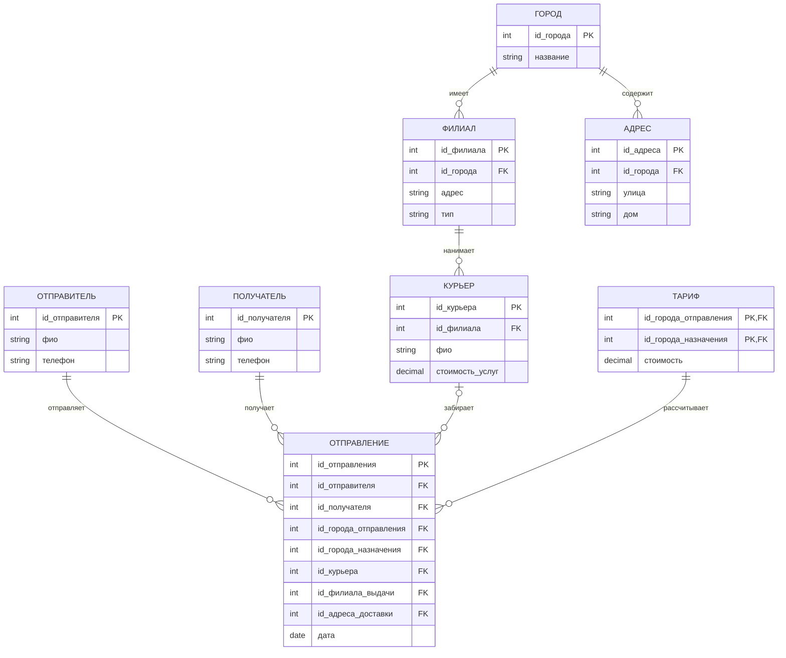

### Реляционная модель

#### ГОРОД

| Атрибут | Тип | ПК | Обяз. | Уник. | Внешний ключ |
|---|---|:---:|:---:|:---:|---|
| id_города | int | + | + | + |  |
| название | string |  | + |  |  |

#### ТАРИФ

| Атрибут | Тип | ПК | Обяз. | Уник. | Внешний ключ |
|---|---|:---:|:---:|:---:|---|
| id_города_отправления | int | + | + | + | Да |
| id_города_назначения | int | + | + | + | Да |
| стоимость | decimal |  | + |  |  |

#### ФИЛИАЛ

| Атрибут | Тип | ПК | Обяз. | Уник. | Внешний ключ |
|---|---|:---:|:---:|:---:|---|
| id_филиала | int | + | + | + |  |
| id_города | int |  | + |  | Да |
| адрес | string |  | + |  |  |
| тип | string |  | + |  |  |

#### ОТПРАВИТЕЛЬ

| Атрибут | Тип | ПК | Обяз. | Уник. | Внешний ключ |
|---|---|:---:|:---:|:---:|---|
| id_отправителя | int | + | + | + |  |
| фио | string |  | + |  |  |
| телефон | string |  | + |  |  |

#### ПОЛУЧАТЕЛЬ

| Атрибут | Тип | ПК | Обяз. | Уник. | Внешний ключ |
|---|---|:---:|:---:|:---:|---|
| id_получателя | int | + | + | + |  |
| фио | string |  | + |  |  |
| телефон | string |  | + |  |  |

#### АДРЕС

| Атрибут | Тип | ПК | Обяз. | Уник. | Внешний ключ |
|---|---|:---:|:---:|:---:|---|
| id_адреса | int | + | + | + |  |
| id_города | int |  | + |  | Да |
| улица | string |  | + |  |  |
| дом | string |  | + |  |  |

#### КУРЬЕР

| Атрибут | Тип | ПК | Обяз. | Уник. | Внешний ключ |
|---|---|:---:|:---:|:---:|---|
| id_курьера | int | + | + | + |  |
| id_филиала | int |  | + |  | Да |
| фио | string |  | + |  |  |
| стоимость_услуг | decimal |  | + |  |  |

#### ОТПРАВЛЕНИЕ

| Атрибут | Тип | ПК | Обяз. | Уник. | Внешний ключ |
|---|---|:---:|:---:|:---:|---|
| id_отправления | int | + | + | + |  |
| id_отправителя | int |  | + |  | Да |
| id_получателя | int |  | + |  | Да |
| id_города_отправления | int |  | + |  | Да |
| id_города_назначения | int |  | + |  | Да |
| id_курьера | int |  | + |  | Да |
| id_филиала_выдачи | int |  | + |  | Да |
| id_адреса_доставки | int |  | + |  | Да |
| дата | date |  | + |  |  |

---

## Задание 6. Повышение квалификации

### Текст задания

6. Повышение квалификации Permalink
Для сотрудников университета организованы курсы по повышению квалификации. Курс ведёт также сотрудник университета. Курс характеризуется датой начала, датой окончания, наименованием. Каждый сотрудник университета может посещать несколько курсов. По окончании курса выдается свидетельство.

### ER-диаграмма

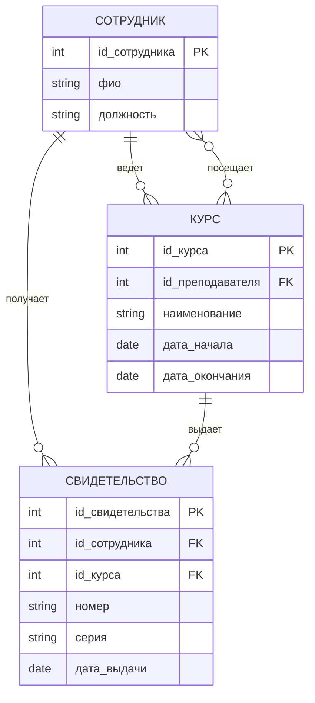

### Реляционная модель

#### СОТРУДНИК

| Атрибут | Тип | ПК | Обяз. | Уник. | Внешний ключ |
|---|---|:---:|:---:|:---:|---|
| id_сотрудника | int | + | + | + |  |
| фио | string |  | + |  |  |
| должность | string |  | + |  |  |

#### КУРС

| Атрибут | Тип | ПК | Обяз. | Уник. | Внешний ключ |
|---|---|:---:|:---:|:---:|---|
| id_курса | int | + | + | + |  |
| id_преподавателя | int |  | + |  | Да |
| наименование | string |  | + |  |  |
| дата_начала | date |  | + |  |  |
| дата_окончания | date |  | + |  |  |

#### СВИДЕТЕЛЬСТВО

| Атрибут | Тип | ПК | Обяз. | Уник. | Внешний ключ |
|---|---|:---:|:---:|:---:|---|
| id_свидетельства | int | + | + | + |  |
| id_сотрудника | int |  | + |  | Да |
| id_курса | int |  | + |  | Да |
| номер | string |  | + |  |  |
| серия | string |  | + |  |  |
| дата_выдачи | date |  | + |  |  |

---

## Задание 7. Научная конференция

### Текст задания

7. Научная конференция Permalink
В университете организуется научная конференция, по результатам проведения которой публикуется сборник статей. Конференция имеет наименование и дату начала и дату окончания. Каждый участник конференции отправляет в адрес конференции статью, которая характеризуется наименованием, списком авторов и количеством листов, а также презентацию наименование которой и список авторов совпадает с наименованием статьи. Конференция разделена на секции. Заседания секций происходит в разных аудиториях с 9:00 до 17:00 с перерывом с 12:00 до 13:00. На представление доклада выделяется 30 минут.

### ER-диаграмма

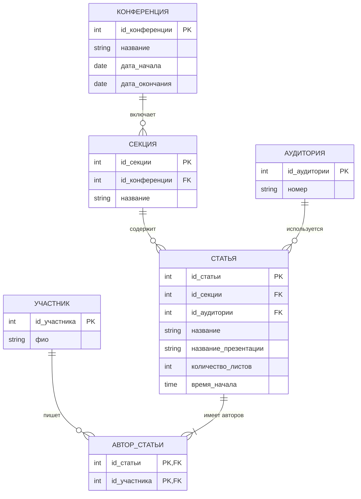

### Реляционная модель

#### КОНФЕРЕНЦИЯ

| Атрибут | Тип | ПК | Обяз. | Уник. | Внешний ключ |
|---|---|:---:|:---:|:---:|---|
| id_конференции | int | + | + | + |  |
| название | string |  | + |  |  |
| дата_начала | date |  | + |  |  |
| дата_окончания | date |  | + |  |  |

#### СЕКЦИЯ

| Атрибут | Тип | ПК | Обяз. | Уник. | Внешний ключ |
|---|---|:---:|:---:|:---:|---|
| id_секции | int | + | + | + |  |
| id_конференции | int |  | + |  | Да |
| название | string |  | + |  |  |

#### УЧАСТНИК

| Атрибут | Тип | ПК | Обяз. | Уник. | Внешний ключ |
|---|---|:---:|:---:|:---:|---|
| id_участника | int | + | + | + |  |
| фио | string |  | + |  |  |

#### СТАТЬЯ

| Атрибут | Тип | ПК | Обяз. | Уник. | Внешний ключ |
|---|---|:---:|:---:|:---:|---|
| id_статьи | int | + | + | + |  |
| id_секции | int |  | + |  | Да |
| id_аудитории | int |  | + |  | Да |
| название | string |  | + |  |  |
| название_презентации | string |  | + |  |  |
| количество_листов | int |  | + |  |  |
| время_начала | time |  | + |  |  |

#### АВТОР_СТАТЬИ

| Атрибут | Тип | ПК | Обяз. | Уник. | Внешний ключ |
|---|---|:---:|:---:|:---:|---|
| id_статьи | int | + | + | + | Да |
| id_участника | int | + | + | + | Да |

#### АУДИТОРИЯ

| Атрибут | Тип | ПК | Обяз. | Уник. | Внешний ключ |
|---|---|:---:|:---:|:---:|---|
| id_аудитории | int | + | + | + |  |
| номер | string |  | + |  |  |

---

## Задание 8. Прокат велосипедов

### Текст задания

8. Прокат велосипедов Permalink
Компания по прокату велосипедов имеет филиалы в нескольких городах. Каждый филиал имеет парк и нескольких сотен велосипедов разных трех марок. Для аренды велосипеда клиенты используют мобильное приложение, в котором указывается имя клиента и привязанная к приложению банковская карта или электронный кошелек. Для каждого типа велосипеда существует собственная стоимость одного часа аренды, котора также зависит от города, где находится филиал. В информационной системе учитывается продолжительность аренды, стоимость услуги (после возвращения велосипеда).

### ER-диаграмма

```mermaid
erDiagram
    ФИЛИАЛ {
        int id_филиала PK
        string город
        string адрес
    }
    МАРКА {
        int id_марки PK
        string название
    }
    ТАРИФ {
        int id_марки PK, FK
        int id_филиала PK, FK
        decimal стоимость_часа
    }
    ВЕЛОСИПЕД {
        int id_велосипеда PK
        int id_филиала FK
        int id_марки FK
        string инвентарный_номер UQ
    }
    КЛИЕНТ {
        int id_клиента PK
        string имя
        string телефон
        string платежные_данные
    }
    АРЕНДА {
        int id_аренды PK
        int id_клиента FK
        int id_велосипеда FK
        decimal продолжительность
        decimal стоимость
    }

    ФИЛИАЛ ||--o{ ВЕЛОСИПЕД : "содержит"
    МАРКА ||--o{ ВЕЛОСИПЕД : "определяет"
    ФИЛИАЛ ||--o{ ТАРИФ : "имеет"
    МАРКА ||--o{ ТАРИФ : "тарифицируется"
    КЛИЕНТ ||--o{ АРЕНДА : "оформляет"
    ВЕЛОСИПЕД ||--o{ АРЕНДА : "арендуется"
```

### Реляционная модель

#### ФИЛИАЛ

| Атрибут | Тип | ПК | Обяз. | Уник. | Внешний ключ |
|---|---|:---:|:---:|:---:|---|
| id_филиала | int | + | + | + |  |
| город | string |  | + |  |  |
| адрес | string |  | + |  |  |

#### МАРКА

| Атрибут | Тип | ПК | Обяз. | Уник. | Внешний ключ |
|---|---|:---:|:---:|:---:|---|
| id_марки | int | + | + | + |  |
| название | string |  | + |  |  |

#### ТАРИФ

| Атрибут | Тип | ПК | Обяз. | Уник. | Внешний ключ |
|---|---|:---:|:---:|:---:|---|
| id_марки | int | + | + | + | Да |
| id_филиала | int | + | + | + | Да |
| стоимость_часа | decimal |  | + |  |  |

#### ВЕЛОСИПЕД

| Атрибут | Тип | ПК | Обяз. | Уник. | Внешний ключ |
|---|---|:---:|:---:|:---:|---|
| id_велосипеда | int | + | + | + |  |
| id_филиала | int |  | + |  | Да |
| id_марки | int |  | + |  | Да |
| инвентарный_номер | string |  | + | + |  |

#### КЛИЕНТ

| Атрибут | Тип | ПК | Обяз. | Уник. | Внешний ключ |
|---|---|:---:|:---:|:---:|---|
| id_клиента | int | + | + | + |  |
| имя | string |  | + |  |  |
| телефон | string |  | + |  |  |
| платежные_данные | string |  | + |  |  |

#### АРЕНДА

| Атрибут | Тип | ПК | Обяз. | Уник. | Внешний ключ |
|---|---|:---:|:---:|:---:|---|
| id_аренды | int | + | + | + |  |
| id_клиента | int |  | + |  | Да |
| id_велосипеда | int |  | + |  | Да |
| продолжительность | decimal |  | + |  |  |
| стоимость | decimal |  | + |  |  |

---

## Задание 9. Футбольный турнир

### Текст задания

9. Футбольный турнир (РФПЛ) Permalink
Информационная система поддержки проведения футбольного турнира. Учёт команд, игроков, тренеров, матчей и их результатов (голы, авторы голов), стадионов, количества зрителей каждой игры.

### ER-диаграмма

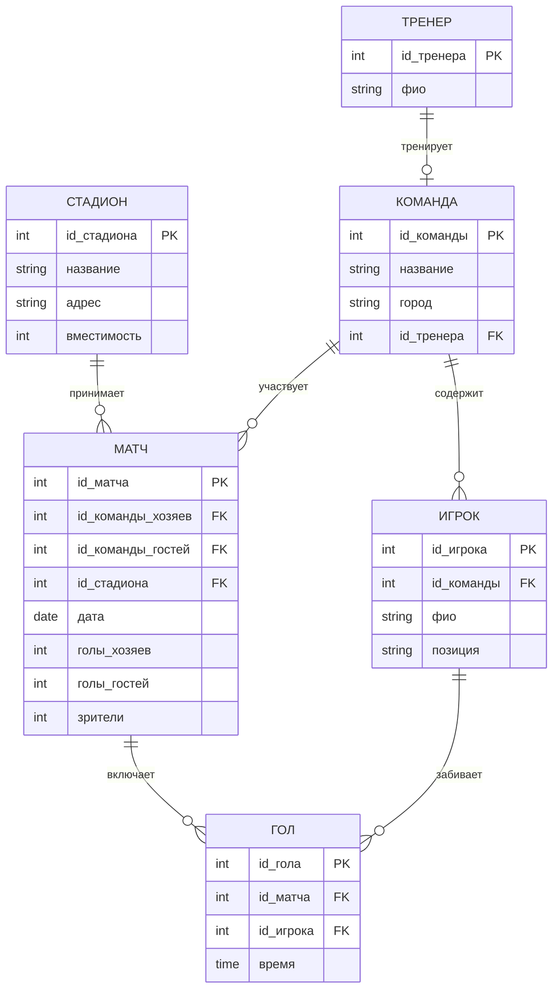

### Реляционная модель

#### КОМАНДА

| Атрибут | Тип | ПК | Обяз. | Уник. | Внешний ключ |
|---|---|:---:|:---:|:---:|---|
| id_команды | int | + | + | + |  |
| название | string |  | + |  |  |
| город | string |  | + |  |  |
| id_тренера | int |  | + |  | Да |

#### ИГРОК

| Атрибут | Тип | ПК | Обяз. | Уник. | Внешний ключ |
|---|---|:---:|:---:|:---:|---|
| id_игрока | int | + | + | + |  |
| id_команды | int |  | + |  | Да |
| фио | string |  | + |  |  |
| позиция | string |  | + |  |  |

#### ТРЕНЕР

| Атрибут | Тип | ПК | Обяз. | Уник. | Внешний ключ |
|---|---|:---:|:---:|:---:|---|
| id_тренера | int | + | + | + |  |
| фио | string |  | + |  |  |

#### СТАДИОН

| Атрибут | Тип | ПК | Обяз. | Уник. | Внешний ключ |
|---|---|:---:|:---:|:---:|---|
| id_стадиона | int | + | + | + |  |
| название | string |  | + |  |  |
| адрес | string |  | + |  |  |
| вместимость | int |  | + |  |  |

#### МАТЧ

| Атрибут | Тип | ПК | Обяз. | Уник. | Внешний ключ |
|---|---|:---:|:---:|:---:|---|
| id_матча | int | + | + | + |  |
| id_команды_хозяев | int |  | + |  | Да |
| id_команды_гостей | int |  | + |  | Да |
| id_стадиона | int |  | + |  | Да |
| дата | date |  | + |  |  |
| голы_хозяев | int |  | + |  |  |
| голы_гостей | int |  | + |  |  |
| зрители | int |  | + |  |  |

#### ГОЛ

| Атрибут | Тип | ПК | Обяз. | Уник. | Внешний ключ |
|---|---|:---:|:---:|:---:|---|
| id_гола | int | + | + | + |  |
| id_матча | int |  | + |  | Да |
| id_игрока | int |  | + |  | Да |
| время | time |  | + |  |  |

---

## Задание 10. Пиццерия

### Текст задания

10. Пиццерия Permalink
Сеть пиццерий доставляет пиццы клиентам, которые заказывают их по телефону или через интернет. Имеется ограниченный набор типов пицц. Каждый тип пиццы имеет свой набор продуктов для изготовления и количество. Заказ доставляется курьером по адресу, указанному клиентом.

### ER-диаграмма

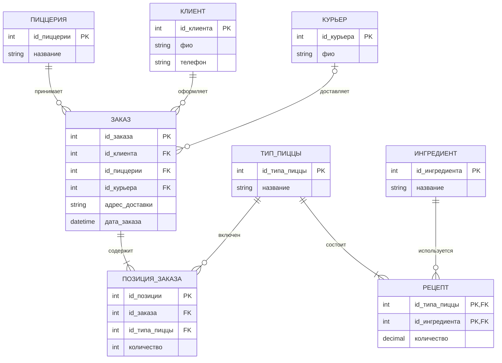

### Реляционная модель

#### ПИЦЦЕРИЯ

| Атрибут | Тип | ПК | Обяз. | Уник. | Внешний ключ |
|---|---|:---:|:---:|:---:|---|
| id_пиццерии | int | + | + | + |  |
| название | string |  | + |  |  |

#### КЛИЕНТ

| Атрибут | Тип | ПК | Обяз. | Уник. | Внешний ключ |
|---|---|:---:|:---:|:---:|---|
| id_клиента | int | + | + | + |  |
| фио | string |  | + |  |  |
| телефон | string |  | + |  |  |

#### ЗАКАЗ

| Атрибут | Тип | ПК | Обяз. | Уник. | Внешний ключ |
|---|---|:---:|:---:|:---:|---|
| id_заказа | int | + | + | + |  |
| id_клиента | int |  | + |  | Да |
| id_пиццерии | int |  | + |  | Да |
| id_курьера | int |  | + |  | Да |
| адрес_доставки | string |  | + |  |  |
| дата_заказа | datetime |  | + |  |  |

#### ТИП_ПИЦЦЫ

| Атрибут | Тип | ПК | Обяз. | Уник. | Внешний ключ |
|---|---|:---:|:---:|:---:|---|
| id_типа_пиццы | int | + | + | + |  |
| название | string |  | + |  |  |

#### ПОЗИЦИЯ_ЗАКАЗА

| Атрибут | Тип | ПК | Обяз. | Уник. | Внешний ключ |
|---|---|:---:|:---:|:---:|---|
| id_позиции | int | + | + | + |  |
| id_заказа | int |  | + |  | Да |
| id_типа_пиццы | int |  | + |  | Да |
| количество | int |  | + |  |  |

#### ИНГРЕДИЕНТ

| Атрибут | Тип | ПК | Обяз. | Уник. | Внешний ключ |
|---|---|:---:|:---:|:---:|---|
| id_ингредиента | int | + | + | + |  |
| название | string |  | + |  |  |

#### РЕЦЕПТ

| Атрибут | Тип | ПК | Обяз. | Уник. | Внешний ключ |
|---|---|:---:|:---:|:---:|---|
| id_типа_пиццы | int | + | + | + | Да |
| id_ингредиента | int | + | + | + | Да |
| количество | decimal |  | + |  |  |

#### КУРЬЕР

| Атрибут | Тип | ПК | Обяз. | Уник. | Внешний ключ |
|---|---|:---:|:---:|:---:|---|
| id_курьера | int | + | + | + |  |
| фио | string |  | + |  |  |

---

## Задание 11. Кулинарная книга

### Текст задания

11. Кулинарная книга Permalink
Рецепты
наименование
описание
источник
тип
время приготовления
Компоненты рецепта
продукт
количество
Справочник продуктов
наименование
цена
единица измерения
калорийность

### ER-диаграмма

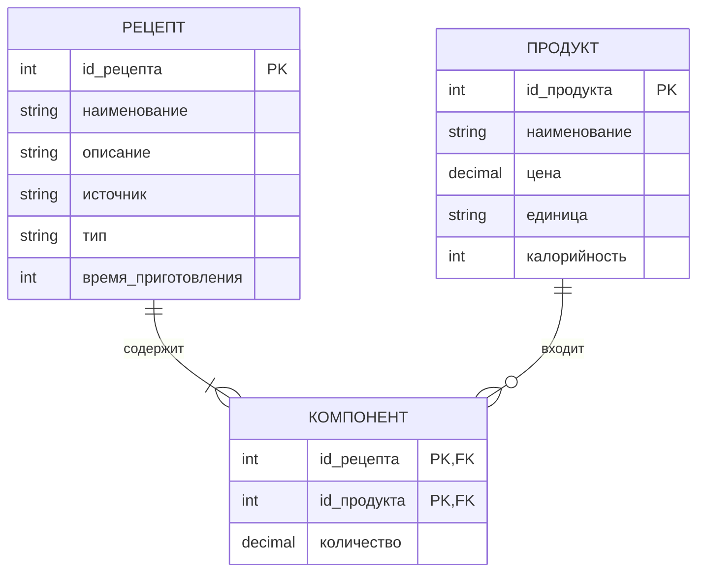

### Реляционная модель

#### РЕЦЕПТ

| Атрибут | Тип | ПК | Обяз. | Уник. | Внешний ключ |
|---|---|:---:|:---:|:---:|---|
| id_рецепта | int | + | + | + |  |
| наименование | string |  | + |  |  |
| описание | string |  | + |  |  |
| источник | string |  | + |  |  |
| тип | string |  | + |  |  |
| время_приготовления | int |  | + |  |  |

#### ПРОДУКТ

| Атрибут | Тип | ПК | Обяз. | Уник. | Внешний ключ |
|---|---|:---:|:---:|:---:|---|
| id_продукта | int | + | + | + |  |
| наименование | string |  | + |  |  |
| цена | decimal |  | + |  |  |
| единица | string |  | + |  |  |
| калорийность | int |  | + |  |  |

#### КОМПОНЕНТ

| Атрибут | Тип | ПК | Обяз. | Уник. | Внешний ключ |
|---|---|:---:|:---:|:---:|---|
| id_рецепта | int | + | + | + | Да |
| id_продукта | int | + | + | + | Да |
| количество | decimal |  | + |  |  |

---

## Задание 12. Поликлиника

### Текст задания

12. Поликлиника Permalink
Информационная система сети поликлиник содержит информацию о врачах и о пациентах. Запись о каждом враче содержит: ФИО, адрес, дату рождения, паспортные данные, специальность, стаж. Информация о пациенте (посетителе): ФИО, дата рождения, номер полиса. Информационная система должна вести учет посещений (дата, врач, посетитель, диагноз).

### ER-диаграмма

```mermaid
erDiagram
    ВРАЧ {
        int id_врача PK
        string фио
        string адрес
        date дата_рождения
        string паспорт
        string специальность
        int стаж
    }
    ПАЦИЕНТ {
        int id_пациента PK
        string фио
        date дата_рождения
        string полис UQ
    }
    ПОСЕЩЕНИЕ {
        int id_посещения PK
        int id_врача FK
        int id_пациента FK
        date дата
        string диагноз
    }

    ВРАЧ ||--o{ ПОСЕЩЕНИЕ : "проводит"
    ПАЦИЕНТ ||--o{ ПОСЕЩЕНИЕ : "совершает"
```

### Реляционная модель

#### ВРАЧ

| Атрибут | Тип | ПК | Обяз. | Уник. | Внешний ключ |
|---|---|:---:|:---:|:---:|---|
| id_врача | int | + | + | + |  |
| фио | string |  | + |  |  |
| адрес | string |  | + |  |  |
| дата_рождения | date |  | + |  |  |
| паспорт | string |  | + |  |  |
| специальность | string |  | + |  |  |
| стаж | int |  | + |  |  |

#### ПАЦИЕНТ

| Атрибут | Тип | ПК | Обяз. | Уник. | Внешний ключ |
|---|---|:---:|:---:|:---:|---|
| id_пациента | int | + | + | + |  |
| фио | string |  | + |  |  |
| дата_рождения | date |  | + |  |  |
| полис | string |  | + | + |  |

#### ПОСЕЩЕНИЕ

| Атрибут | Тип | ПК | Обяз. | Уник. | Внешний ключ |
|---|---|:---:|:---:|:---:|---|
| id_посещения | int | + | + | + |  |
| id_врача | int |  | + |  | Да |
| id_пациента | int |  | + |  | Да |
| дата | date |  | + |  |  |
| диагноз | string |  | + |  |  |

---

## Задание 13. Сессия

### Текст задания

13. Сессия Permalink
Студенты, экзаменаторы (преподаватели), зачетные книжки, экзамены, зачеты.

### ER-диаграмма

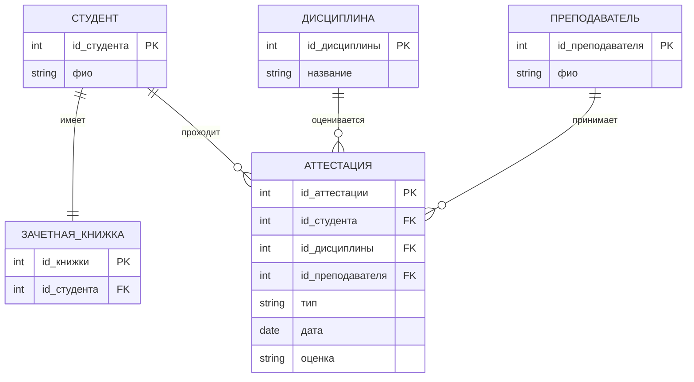

### Реляционная модель

#### СТУДЕНТ

| Атрибут | Тип | ПК | Обяз. | Уник. | Внешний ключ |
|---|---|:---:|:---:|:---:|---|
| id_студента | int | + | + | + |  |
| фио | string |  | + |  |  |

#### ПРЕПОДАВАТЕЛЬ

| Атрибут | Тип | ПК | Обяз. | Уник. | Внешний ключ |
|---|---|:---:|:---:|:---:|---|
| id_преподавателя | int | + | + | + |  |
| фио | string |  | + |  |  |

#### ЗАЧЕТНАЯ_КНИЖКА

| Атрибут | Тип | ПК | Обяз. | Уник. | Внешний ключ |
|---|---|:---:|:---:|:---:|---|
| id_книжки | int | + | + | + |  |
| id_студента | int |  | + |  | Да |

#### ДИСЦИПЛИНА

| Атрибут | Тип | ПК | Обяз. | Уник. | Внешний ключ |
|---|---|:---:|:---:|:---:|---|
| id_дисциплины | int | + | + | + |  |
| название | string |  | + |  |  |

#### АТТЕСТАЦИЯ

| Атрибут | Тип | ПК | Обяз. | Уник. | Внешний ключ |
|---|---|:---:|:---:|:---:|---|
| id_аттестации | int | + | + | + |  |
| id_студента | int |  | + |  | Да |
| id_дисциплины | int |  | + |  | Да |
| id_преподавателя | int |  | + |  | Да |
| тип | string |  | + |  |  |
| дата | date |  | + |  |  |
| оценка | string |  | + |  |  |

---

## Задание 14. Расписание занятий

### Текст задания

14. Расписание занятий Permalink
Расписание
неделя
день
пара
группа
преподаватель
вид занятий
аудитория
Преподаватель
кафедра
должность
ученая степень
Пара
номер
время начала
время окончания
Аудитория
корпус
номер
Группа
номер
количество студентов

### ER-диаграмма

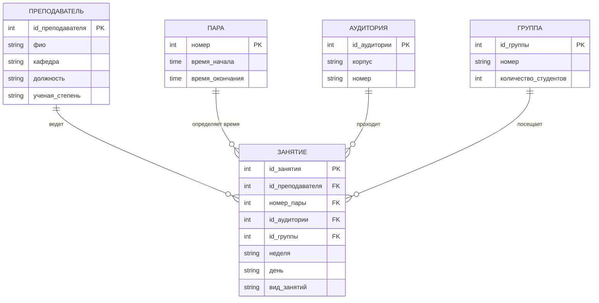

### Реляционная модель

#### ПРЕПОДАВАТЕЛЬ

| Атрибут | Тип | ПК | Обяз. | Уник. | Внешний ключ |
|---|---|:---:|:---:|:---:|---|
| id_преподавателя | int | + | + | + |  |
| фио | string |  | + |  |  |
| кафедра | string |  | + |  |  |
| должность | string |  | + |  |  |
| ученая_степень | string |  | + |  |  |

#### ПАРА

| Атрибут | Тип | ПК | Обяз. | Уник. | Внешний ключ |
|---|---|:---:|:---:|:---:|---|
| номер | int | + | + | + |  |
| время_начала | time |  | + |  |  |
| время_окончания | time |  | + |  |  |

#### АУДИТОРИЯ

| Атрибут | Тип | ПК | Обяз. | Уник. | Внешний ключ |
|---|---|:---:|:---:|:---:|---|
| id_аудитории | int | + | + | + |  |
| корпус | string |  | + |  |  |
| номер | string |  | + |  |  |

#### ГРУППА

| Атрибут | Тип | ПК | Обяз. | Уник. | Внешний ключ |
|---|---|:---:|:---:|:---:|---|
| id_группы | int | + | + | + |  |
| номер | string |  | + |  |  |
| количество_студентов | int |  | + |  |  |

#### ЗАНЯТИЕ

| Атрибут | Тип | ПК | Обяз. | Уник. | Внешний ключ |
|---|---|:---:|:---:|:---:|---|
| id_занятия | int | + | + | + |  |
| id_преподавателя | int |  | + |  | Да |
| номер_пары | int |  | + |  | Да |
| id_аудитории | int |  | + |  | Да |
| id_группы | int |  | + |  | Да |
| неделя | string |  | + |  |  |
| день | string |  | + |  |  |
| вид_занятий | string |  | + |  |  |

---

## Задание 15. Социальная сеть

### Текст задания

15. Социальная сеть Permalink
Изобразите диаграмму сущность-связь для социальной сети ВКонтакте.

### ER-диаграмма

```mermaid
erDiagram
    ПОЛЬЗОВАТЕЛЬ {
        int id_пользователя PK
        string фио
        string логин UQ
        string дата_рождения
    }
    ПУБЛИКАЦИЯ {
        int id_публикации PK
        int id_пользователя FK
        string текст
        datetime дата
    }
    ДРУЖБА {
        int id_пользователя_1 PK, FK
        int id_пользователя_2 PK, FK
        date дата
    }
    СООБЩЕНИЕ {
        int id_сообщения PK
        int id_отправителя FK
        int id_получателя FK
        string текст
        datetime дата
    }
    ГРУППА {
        int id_группы PK
        string название
    }
    УЧАСТНИК_ГРУППЫ {
        int id_группы PK, FK
        int id_пользователя PK, FK
    }

    ПОЛЬЗОВАТЕЛЬ ||--o{ ПУБЛИКАЦИЯ : "создает"
    ПОЛЬЗОВАТЕЛЬ }o--o{ ДРУЖБА : "дружит"
    ПОЛЬЗОВАТЕЛЬ ||--o{ СООБЩЕНИЕ : "отправляет"
    ПОЛЬЗОВАТЕЛЬ ||--o{ СООБЩЕНИЕ : "получает"
    ГРУППА ||--o{ УЧАСТНИК_ГРУППЫ : "включает"
    ПОЛЬЗОВАТЕЛЬ ||--o{ УЧАСТНИК_ГРУППЫ : "вступает"
```

### Реляционная модель

#### ПОЛЬЗОВАТЕЛЬ

| Атрибут | Тип | ПК | Обяз. | Уник. | Внешний ключ |
|---|---|:---:|:---:|:---:|---|
| id_пользователя | int | + | + | + |  |
| фио | string |  | + |  |  |
| логин | string |  | + | + |  |
| дата_рождения | string |  | + |  |  |

#### ПУБЛИКАЦИЯ

| Атрибут | Тип | ПК | Обяз. | Уник. | Внешний ключ |
|---|---|:---:|:---:|:---:|---|
| id_публикации | int | + | + | + |  |
| id_пользователя | int |  | + |  | Да |
| текст | string |  | + |  |  |
| дата | datetime |  | + |  |  |

#### ДРУЖБА

| Атрибут | Тип | ПК | Обяз. | Уник. | Внешний ключ |
|---|---|:---:|:---:|:---:|---|
| id_пользователя_1 | int | + | + | + | Да |
| id_пользователя_2 | int | + | + | + | Да |
| дата | date |  | + |  |  |

#### СООБЩЕНИЕ

| Атрибут | Тип | ПК | Обяз. | Уник. | Внешний ключ |
|---|---|:---:|:---:|:---:|---|
| id_сообщения | int | + | + | + |  |
| id_отправителя | int |  | + |  | Да |
| id_получателя | int |  | + |  | Да |
| текст | string |  | + |  |  |
| дата | datetime |  | + |  |  |

#### ГРУППА

| Атрибут | Тип | ПК | Обяз. | Уник. | Внешний ключ |
|---|---|:---:|:---:|:---:|---|
| id_группы | int | + | + | + |  |
| название | string |  | + |  |  |

#### УЧАСТНИК_ГРУППЫ

| Атрибут | Тип | ПК | Обяз. | Уник. | Внешний ключ |
|---|---|:---:|:---:|:---:|---|
| id_группы | int | + | + | + | Да |
| id_пользователя | int | + | + | + | Да |

---

## Задание 16. Интернет-магазин мебели

### Текст задания

16. Интернет-магазин мебели Permalink
Интернет-магазин мебели позволяет покупателю выбрать на сайте товар оплатить его, заказать при необходимости доставку товара, оплатить его на сайте (способ оплаты) или после доставки, заказать сборку товара.

### ER-диаграмма

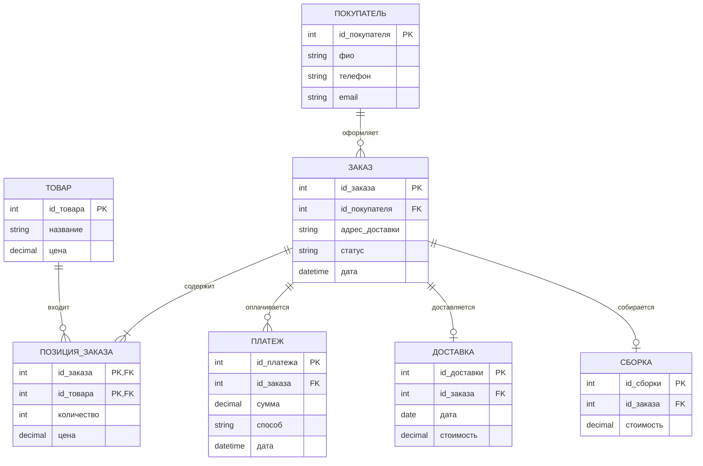

### Реляционная модель

#### ПОКУПАТЕЛЬ

| Атрибут | Тип | ПК | Обяз. | Уник. | Внешний ключ |
|---|---|:---:|:---:|:---:|---|
| id_покупателя | int | + | + | + |  |
| фио | string |  | + |  |  |
| телефон | string |  | + |  |  |
| email | string |  | + |  |  |

#### ТОВАР

| Атрибут | Тип | ПК | Обяз. | Уник. | Внешний ключ |
|---|---|:---:|:---:|:---:|---|
| id_товара | int | + | + | + |  |
| название | string |  | + |  |  |
| цена | decimal |  | + |  |  |

#### ЗАКАЗ

| Атрибут | Тип | ПК | Обяз. | Уник. | Внешний ключ |
|---|---|:---:|:---:|:---:|---|
| id_заказа | int | + | + | + |  |
| id_покупателя | int |  | + |  | Да |
| адрес_доставки | string |  | + |  |  |
| статус | string |  | + |  |  |
| дата | datetime |  | + |  |  |

#### ПОЗИЦИЯ_ЗАКАЗА

| Атрибут | Тип | ПК | Обяз. | Уник. | Внешний ключ |
|---|---|:---:|:---:|:---:|---|
| id_заказа | int | + | + | + | Да |
| id_товара | int | + | + | + | Да |
| количество | int |  | + |  |  |
| цена | decimal |  | + |  |  |

#### ПЛАТЕЖ

| Атрибут | Тип | ПК | Обяз. | Уник. | Внешний ключ |
|---|---|:---:|:---:|:---:|---|
| id_платежа | int | + | + | + |  |
| id_заказа | int |  | + |  | Да |
| сумма | decimal |  | + |  |  |
| способ | string |  | + |  |  |
| дата | datetime |  | + |  |  |

#### ДОСТАВКА

| Атрибут | Тип | ПК | Обяз. | Уник. | Внешний ключ |
|---|---|:---:|:---:|:---:|---|
| id_доставки | int | + | + | + |  |
| id_заказа | int |  | + |  | Да |
| дата | date |  | + |  |  |
| стоимость | decimal |  | + |  |  |

#### СБОРКА

| Атрибут | Тип | ПК | Обяз. | Уник. | Внешний ключ |
|---|---|:---:|:---:|:---:|---|
| id_сборки | int | + | + | + |  |
| id_заказа | int |  | + |  | Да |
| стоимость | decimal |  | + |  |  |

---

## Задание 17. Онлайн кинотеатр

### Текст задания

17. Онлайн кинотеатр Permalink
В онлайн-кинотеатре можно смотреть фильмы по подписке или покупать отдельные фильмы для просмотра в любое время или брать фильмы на прокат, для просмотра в течение одного месяца после оплаты. Подписка может быть индивидуальной или семейной на несколько пользователей (до пяти), связанных с “администратором” семьи. Каждый пользователь имеет жанровые предпочтения. Информационная система должна вести учет пользователей, их подписок, покупок, просмотренных фильмов, жанровых предпочтений.

### ER-диаграмма

```mermaid
erDiagram
    ПОЛЬЗОВАТЕЛЬ {
        int id_пользователя PK
        string имя
        string email UQ
    }
    ФИЛЬМ {
        int id_фильма PK
        string название
        int год
    }
    ЖАНР {
        int id_жанра PK
        string название
    }
    ПОДПИСКА {
        int id_подписки PK
        int id_администратора FK
        string тип
        date начало
        date окончание
    }
    УЧАСТНИК_ПОДПИСКИ {
        int id_подписки PK, FK
        int id_пользователя PK, FK
    }
    ПОКУПКА {
        int id_покупки PK
        int id_пользователя FK
        int id_фильма FK
        date дата
    }
    ПРОСМОТР {
        int id_пользователя PK, FK
        int id_фильма PK, FK
        datetime дата
    }
    ПРЕДПОЧТЕНИЕ {
        int id_пользователя PK, FK
        int id_жанра PK, FK
    }

    ПОЛЬЗОВАТЕЛЬ ||--o{ ПОДПИСКА : "администрирует"
    ПОДПИСКА ||--|{ УЧАСТНИК_ПОДПИСКИ : "объединяет"
    ПОЛЬЗОВАТЕЛЬ ||--o{ ПОКУПКА : "покупает"
    ФИЛЬМ ||--o{ ПОКУПКА : "продается"
    ПОЛЬЗОВАТЕЛЬ }o--o{ ФИЛЬМ : "смотрит"
    ПОЛЬЗОВАТЕЛЬ }o--o{ ЖАНР : "предпочитает"
```

### Реляционная модель

#### ПОЛЬЗОВАТЕЛЬ

| Атрибут | Тип | ПК | Обяз. | Уник. | Внешний ключ |
|---|---|:---:|:---:|:---:|---|
| id_пользователя | int | + | + | + |  |
| имя | string |  | + |  |  |
| email | string |  | + | + |  |

#### ФИЛЬМ

| Атрибут | Тип | ПК | Обяз. | Уник. | Внешний ключ |
|---|---|:---:|:---:|:---:|---|
| id_фильма | int | + | + | + |  |
| название | string |  | + |  |  |
| год | int |  | + |  |  |

#### ЖАНР

| Атрибут | Тип | ПК | Обяз. | Уник. | Внешний ключ |
|---|---|:---:|:---:|:---:|---|
| id_жанра | int | + | + | + |  |
| название | string |  | + |  |  |

#### ПОДПИСКА

| Атрибут | Тип | ПК | Обяз. | Уник. | Внешний ключ |
|---|---|:---:|:---:|:---:|---|
| id_подписки | int | + | + | + |  |
| id_администратора | int |  | + |  | Да |
| тип | string |  | + |  |  |
| начало | date |  | + |  |  |
| окончание | date |  | + |  |  |

#### УЧАСТНИК_ПОДПИСКИ

| Атрибут | Тип | ПК | Обяз. | Уник. | Внешний ключ |
|---|---|:---:|:---:|:---:|---|
| id_подписки | int | + | + | + | Да |
| id_пользователя | int | + | + | + | Да |

#### ПОКУПКА

| Атрибут | Тип | ПК | Обяз. | Уник. | Внешний ключ |
|---|---|:---:|:---:|:---:|---|
| id_покупки | int | + | + | + |  |
| id_пользователя | int |  | + |  | Да |
| id_фильма | int |  | + |  | Да |
| дата | date |  | + |  |  |

#### ПРОСМОТР

| Атрибут | Тип | ПК | Обяз. | Уник. | Внешний ключ |
|---|---|:---:|:---:|:---:|---|
| id_пользователя | int | + | + | + | Да |
| id_фильма | int | + | + | + | Да |
| дата | datetime |  | + |  |  |

#### ПРЕДПОЧТЕНИЕ

| Атрибут | Тип | ПК | Обяз. | Уник. | Внешний ключ |
|---|---|:---:|:---:|:---:|---|
| id_пользователя | int | + | + | + | Да |
| id_жанра | int | + | + | + | Да |

---

## Задание 18. Бронирование авиабилетов

### Текст задания

18. Бронирование авиабилетов Permalink
На сайте авиакомпании пассажир может заказать билеты для себя и еще нескольких человек для перелета из пункта А в пункт Б (может быть несколько перелетов) на определенную дату. При покупке билета для каждого пассажира указывается вес багажа и тип меню для обеда на борту самолета.

### ER-диаграмма

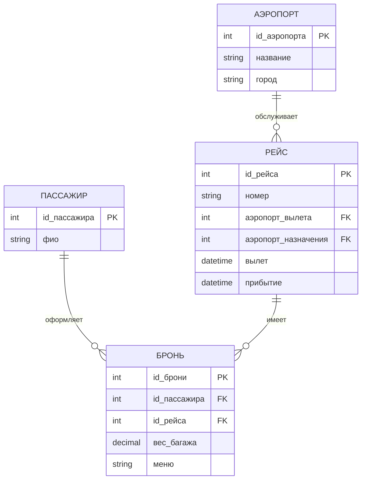

### Реляционная модель

#### ПАССАЖИР

| Атрибут | Тип | ПК | Обяз. | Уник. | Внешний ключ |
|---|---|:---:|:---:|:---:|---|
| id_пассажира | int | + | + | + |  |
| фио | string |  | + |  |  |

#### АЭРОПОРТ

| Атрибут | Тип | ПК | Обяз. | Уник. | Внешний ключ |
|---|---|:---:|:---:|:---:|---|
| id_аэропорта | int | + | + | + |  |
| название | string |  | + |  |  |
| город | string |  | + |  |  |

#### РЕЙС

| Атрибут | Тип | ПК | Обяз. | Уник. | Внешний ключ |
|---|---|:---:|:---:|:---:|---|
| id_рейса | int | + | + | + |  |
| номер | string |  | + |  |  |
| аэропорт_вылета | int |  | + |  | Да |
| аэропорт_назначения | int |  | + |  | Да |
| вылет | datetime |  | + |  |  |
| прибытие | datetime |  | + |  |  |

#### БРОНЬ

| Атрибут | Тип | ПК | Обяз. | Уник. | Внешний ключ |
|---|---|:---:|:---:|:---:|---|
| id_брони | int | + | + | + |  |
| id_пассажира | int |  | + |  | Да |
| id_рейса | int |  | + |  | Да |
| вес_багажа | decimal |  | + |  |  |
| меню | string |  | + |  |  |

---

## Задание 19. Музыкальные альбомы

### Текст задания

19. Музыкальные альбомы Permalink
Коллекция состоит из музыкальных альбомов, которые могут быть записаны на Audio CD, или на жестком диске. Каждый альбом создан одним автором (исполнителем). У каждого исполнителя может быть несколько альбомов. Каждый альбом содержит несколько треков (композиций), которые имеют определенную длину и порядок в альбоме. Каждый трек может быть только в одном альбоме.

### ER-диаграмма

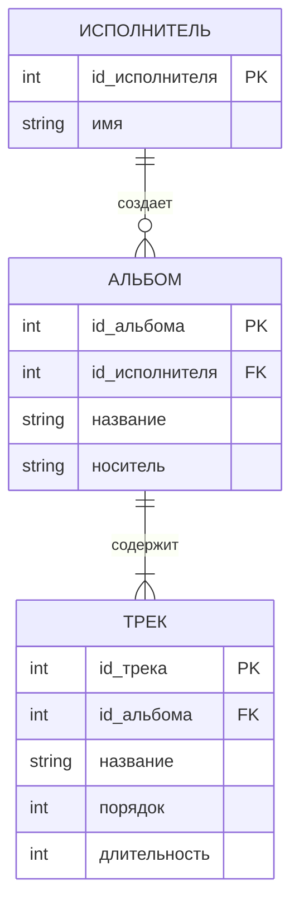

### Реляционная модель

#### ИСПОЛНИТЕЛЬ

| Атрибут | Тип | ПК | Обяз. | Уник. | Внешний ключ |
|---|---|:---:|:---:|:---:|---|
| id_исполнителя | int | + | + | + |  |
| имя | string |  | + |  |  |

#### АЛЬБОМ

| Атрибут | Тип | ПК | Обяз. | Уник. | Внешний ключ |
|---|---|:---:|:---:|:---:|---|
| id_альбома | int | + | + | + |  |
| id_исполнителя | int |  | + |  | Да |
| название | string |  | + |  |  |
| носитель | string |  | + |  |  |

#### ТРЕК

| Атрибут | Тип | ПК | Обяз. | Уник. | Внешний ключ |
|---|---|:---:|:---:|:---:|---|
| id_трека | int | + | + | + |  |
| id_альбома | int |  | + |  | Да |
| название | string |  | + |  |  |
| порядок | int |  | + |  |  |
| длительность | int |  | + |  |  |

---

## Задание 20. Рейсы и бронирование

### Текст задания

20. Бронирование авиабилетов Permalink
База данных рейсов хранит информацию о парке авиакомпании, рейсах и бронировании мест. У авиакомпании есть один или несколько самолетов. Самолет имеет номер модели, уникальный регистрационный номер и возможность принять одного или нескольких пассажиров. У рейса самолета есть уникальный номер рейса, аэропорт вылета, аэропорт назначения, дата и время вылета, а также дата и время прибытия. Каждый полет выполняется одним самолетом. Пассажир назвал имена, фамилию и уникальный адрес электронной почты. Пассажир может забронировать место на рейс.

### ER-диаграмма

```mermaid
erDiagram
    САМОЛЕТ {
        int id_самолета PK
        string модель
        string регистрационный_номер UQ
        int вместимость
    }
    РЕЙС {
        int id_рейса PK
        string номер_рейса UQ
        int id_самолета FK
        string аэропорт_вылета
        string аэропорт_назначения
        datetime вылет
        datetime прибытие
    }
    ПАССАЖИР {
        int id_пассажира PK
        string имя
        string фамилия
        string email UQ
    }
    БРОНИРОВАНИЕ {
        int id_рейса PK, FK
        int id_пассажира PK, FK
        string место
    }

    САМОЛЕТ ||--o{ РЕЙС : "выполняет"
    РЕЙС ||--o{ БРОНИРОВАНИЕ : "принимает"
    ПАССАЖИР ||--o{ БРОНИРОВАНИЕ : "бронирует"
```

### Реляционная модель

#### САМОЛЕТ

| Атрибут | Тип | ПК | Обяз. | Уник. | Внешний ключ |
|---|---|:---:|:---:|:---:|---|
| id_самолета | int | + | + | + |  |
| модель | string |  | + |  |  |
| регистрационный_номер | string |  | + | + |  |
| вместимость | int |  | + |  |  |

#### РЕЙС

| Атрибут | Тип | ПК | Обяз. | Уник. | Внешний ключ |
|---|---|:---:|:---:|:---:|---|
| id_рейса | int | + | + | + |  |
| номер_рейса | string |  | + | + |  |
| id_самолета | int |  | + |  | Да |
| аэропорт_вылета | string |  | + |  |  |
| аэропорт_назначения | string |  | + |  |  |
| вылет | datetime |  | + |  |  |
| прибытие | datetime |  | + |  |  |

#### ПАССАЖИР

| Атрибут | Тип | ПК | Обяз. | Уник. | Внешний ключ |
|---|---|:---:|:---:|:---:|---|
| id_пассажира | int | + | + | + |  |
| имя | string |  | + |  |  |
| фамилия | string |  | + |  |  |
| email | string |  | + | + |  |

#### БРОНИРОВАНИЕ

| Атрибут | Тип | ПК | Обяз. | Уник. | Внешний ключ |
|---|---|:---:|:---:|:---:|---|
| id_рейса | int | + | + | + | Да |
| id_пассажира | int | + | + | + | Да |
| место | string |  | + |  |  |

---

## Задание 21. Курсы и студенты

### Текст задания

21. Курсы и студенты Permalink
В базе данных университета хранится информация о студентах, курсах, семестре, в котором студент проходил определенный курс (а также о его оценках, если он его закончил), а также о том, в какую программу обучения записан каждый студент.

Университет предлагает одну или несколько программ. Программа состоит из одного или нескольких курсов. Студент должен зарегистрироваться в программе. Студент проходит курсы, которые являются частью ее программы. У программы есть название, идентификатор программы, общее количество баллов, необходимых для получения диплома, и год ее начала. У курса есть название, идентификатор курса, значение кредитной точки и год, когда он начался. Студенты имеют одно или несколько имен, фамилию, идентификатор студента, дату рождения и год, когда они впервые поступили. Когда студент проходит курс, записывается год и семестр, в котором он пытался его пройти. Когда он заканчивает курс, записывается оценка (например, A или B) и оценка (например, 60 процентов). Каждый курс в программе состоит из года (например, год 1) и семестра (например, 1 семестр).

### ER-диаграмма

```mermaid
erDiagram
    ПРОГРАММА {
        int id_программы PK
        string название
        int баллы_для_диплома
        int год_начала
    }
    КУРС {
        int id_курса PK
        string название
        int кредиты
        int год_начала
    }
    СТУДЕНТ {
        int id_студента PK
        string имена
        string фамилия
        date дата_рождения
        int год_поступления
        int id_программы FK
    }
    КУРС_ПРОГРАММЫ {
        int id_программы PK, FK
        int id_курса PK, FK
        int год_обучения
        int семестр
    }
    ПОПЫТКА {
        int id_студента PK, FK
        int id_курса PK, FK
        int год
        int семестр
        string оценка
        int процент
    }

    ПРОГРАММА ||--o{ СТУДЕНТ : "включает"
    ПРОГРАММА ||--|{ КУРС_ПРОГРАММЫ : "содержит"
    КУРС ||--o{ КУРС_ПРОГРАММЫ : "входит"
    СТУДЕНТ }o--o{ КУРС : "проходит"
```

### Реляционная модель

#### ПРОГРАММА

| Атрибут | Тип | ПК | Обяз. | Уник. | Внешний ключ |
|---|---|:---:|:---:|:---:|---|
| id_программы | int | + | + | + |  |
| название | string |  | + |  |  |
| баллы_для_диплома | int |  | + |  |  |
| год_начала | int |  | + |  |  |

#### КУРС

| Атрибут | Тип | ПК | Обяз. | Уник. | Внешний ключ |
|---|---|:---:|:---:|:---:|---|
| id_курса | int | + | + | + |  |
| название | string |  | + |  |  |
| кредиты | int |  | + |  |  |
| год_начала | int |  | + |  |  |

#### СТУДЕНТ

| Атрибут | Тип | ПК | Обяз. | Уник. | Внешний ключ |
|---|---|:---:|:---:|:---:|---|
| id_студента | int | + | + | + |  |
| имена | string |  | + |  |  |
| фамилия | string |  | + |  |  |
| дата_рождения | date |  | + |  |  |
| год_поступления | int |  | + |  |  |
| id_программы | int |  | + |  | Да |

#### КУРС_ПРОГРАММЫ

| Атрибут | Тип | ПК | Обяз. | Уник. | Внешний ключ |
|---|---|:---:|:---:|:---:|---|
| id_программы | int | + | + | + | Да |
| id_курса | int | + | + | + | Да |
| год_обучения | int |  | + |  |  |
| семестр | int |  | + |  |  |

#### ПОПЫТКА

| Атрибут | Тип | ПК | Обяз. | Уник. | Внешний ключ |
|---|---|:---:|:---:|:---:|---|
| id_студента | int | + | + | + | Да |
| id_курса | int | + | + | + | Да |
| год | int |  | + |  |  |
| семестр | int |  | + |  |  |
| оценка | string |  | + |  |  |
| процент | int |  | + |  |  |

---

## Задание 22. Компания и сотрудники

### Текст задания

22. Компания и сотрудники Permalink
В компании есть несколько отделов. Каждый отдел имеет уникальную идентификацию, название, местонахождение офиса и конкретного сотрудника, который управляет отделом. Отдел контролирует ряд проектов, каждый из которых имеет уникальное имя, уникальный номер и бюджет. У каждого сотрудника есть имя, идентификационный номер, адрес, зарплата и дата рождения. Сотрудник назначен в один отдел, но может участвовать в нескольких проектах. необходимо вести учёт дату начала работы сотрудника в каждом проекте, непосредственного руководителя каждого сотрудника. Необходимо хранить информацию об иждивенцах каждого сотрудника. У каждого иждивенца есть имя, дата рождения и отношения с работником.

### ER-диаграмма

```mermaid
erDiagram
    ОТДЕЛ {
        int id_отдела PK
        string название
        string местонахождение
        int id_управляющего FK
    }
    СОТРУДНИК {
        int id_сотрудника PK
        string фио
        string адрес
        decimal зарплата
        date дата_рождения
        int id_отдела FK
        int id_руководителя FK
    }
    ПРОЕКТ {
        int id_проекта PK
        string название UQ
        string номер UQ
        decimal бюджет
    }
    УЧАСТИЕ {
        int id_сотрудника PK, FK
        int id_проекта PK, FK
        date дата_начала
    }
    ИЖДИВЕНЕЦ {
        int id_иждивенца PK
        int id_сотрудника FK
        string имя
        date дата_рождения
        string отношение
    }

    ОТДЕЛ ||--o{ СОТРУДНИК : "нанимает"
    СОТРУДНИК o|--o{ ОТДЕЛ : "управляет"
    СОТРУДНИК }o--o{ ПРОЕКТ : "участвует"
    СОТРУДНИК ||--o{ ИЖДИВЕНЕЦ : "имеет"
```

### Реляционная модель

#### ОТДЕЛ

| Атрибут | Тип | ПК | Обяз. | Уник. | Внешний ключ |
|---|---|:---:|:---:|:---:|---|
| id_отдела | int | + | + | + |  |
| название | string |  | + |  |  |
| местонахождение | string |  | + |  |  |
| id_управляющего | int |  | + |  | Да |

#### СОТРУДНИК

| Атрибут | Тип | ПК | Обяз. | Уник. | Внешний ключ |
|---|---|:---:|:---:|:---:|---|
| id_сотрудника | int | + | + | + |  |
| фио | string |  | + |  |  |
| адрес | string |  | + |  |  |
| зарплата | decimal |  | + |  |  |
| дата_рождения | date |  | + |  |  |
| id_отдела | int |  | + |  | Да |
| id_руководителя | int |  | + |  | Да |

#### ПРОЕКТ

| Атрибут | Тип | ПК | Обяз. | Уник. | Внешний ключ |
|---|---|:---:|:---:|:---:|---|
| id_проекта | int | + | + | + |  |
| название | string |  | + | + |  |
| номер | string |  | + | + |  |
| бюджет | decimal |  | + |  |  |

#### УЧАСТИЕ

| Атрибут | Тип | ПК | Обяз. | Уник. | Внешний ключ |
|---|---|:---:|:---:|:---:|---|
| id_сотрудника | int | + | + | + | Да |
| id_проекта | int | + | + | + | Да |
| дата_начала | date |  | + |  |  |

#### ИЖДИВЕНЕЦ

| Атрибут | Тип | ПК | Обяз. | Уник. | Внешний ключ |
|---|---|:---:|:---:|:---:|---|
| id_иждивенца | int | + | + | + |  |
| id_сотрудника | int |  | + |  | Да |
| имя | string |  | + |  |  |
| дата_рождения | date |  | + |  |  |
| отношение | string |  | + |  |  |

---

## Задание 23. Галереи

### Текст задания

23. Галереи Permalink
Галереи хранят информацию о художниках, их именах (которые уникальны), местах рождения, возрасте и стиле искусства. У каждого произведения искусства есть автор, год изготовления, название, вид произведения (например, живопись, литография, скульптура, фотография) и цена. Произведения искусства также подразделяются на группы различных видов, например, портреты, натюрморты, произведения Пикассо или произведения 19-го века; произведение может принадлежать более чем одной группе. Каждая группа идентифицируется именем, которое описывает группу. Наконец, галереи хранят информацию о клиентах. Для каждого покупателя галереи сохраняют уникальное имя, адрес, общую сумму денег, потраченных в галерее, а также художников и групп искусства, которые нравятся покупателю.

by Jennifer Polack, Professor of Computer Science at University of Mary Washington

### ER-диаграмма

```mermaid
erDiagram
    ХУДОЖНИК {
        int id_художника PK
        string имя UQ
        string место_рождения
        int возраст
        string стиль
    }
    ПРОИЗВЕДЕНИЕ {
        int id_произведения PK
        int id_художника FK
        int год
        string название
        string вид
        decimal цена
    }
    ГРУППА_ИСКУССТВА {
        int id_группы PK
        string название UQ
    }
    ПРОИЗВЕДЕНИЕ_ГРУППА {
        int id_произведения PK, FK
        int id_группы PK, FK
    }
    КЛИЕНТ {
        int id_клиента PK
        string имя UQ
        string адрес
        decimal потрачено
    }
    ИНТЕРЕС_ХУДОЖНИКА {
        int id_клиента PK, FK
        int id_художника PK, FK
    }
    ИНТЕРЕС_ГРУППЫ {
        int id_клиента PK, FK
        int id_группы PK, FK
    }

    ХУДОЖНИК ||--o{ ПРОИЗВЕДЕНИЕ : "создает"
    ПРОИЗВЕДЕНИЕ }o--o{ ГРУППА_ИСКУССТВА : "входит"
    КЛИЕНТ }o--o{ ХУДОЖНИК : "предпочитает"
    КЛИЕНТ }o--o{ ГРУППА_ИСКУССТВА : "интересуется"
```

### Реляционная модель

#### ХУДОЖНИК

| Атрибут | Тип | ПК | Обяз. | Уник. | Внешний ключ |
|---|---|:---:|:---:|:---:|---|
| id_художника | int | + | + | + |  |
| имя | string |  | + | + |  |
| место_рождения | string |  | + |  |  |
| возраст | int |  | + |  |  |
| стиль | string |  | + |  |  |

#### ПРОИЗВЕДЕНИЕ

| Атрибут | Тип | ПК | Обяз. | Уник. | Внешний ключ |
|---|---|:---:|:---:|:---:|---|
| id_произведения | int | + | + | + |  |
| id_художника | int |  | + |  | Да |
| год | int |  | + |  |  |
| название | string |  | + |  |  |
| вид | string |  | + |  |  |
| цена | decimal |  | + |  |  |

#### ГРУППА_ИСКУССТВА

| Атрибут | Тип | ПК | Обяз. | Уник. | Внешний ключ |
|---|---|:---:|:---:|:---:|---|
| id_группы | int | + | + | + |  |
| название | string |  | + | + |  |

#### ПРОИЗВЕДЕНИЕ_ГРУППА

| Атрибут | Тип | ПК | Обяз. | Уник. | Внешний ключ |
|---|---|:---:|:---:|:---:|---|
| id_произведения | int | + | + | + | Да |
| id_группы | int | + | + | + | Да |

#### КЛИЕНТ

| Атрибут | Тип | ПК | Обяз. | Уник. | Внешний ключ |
|---|---|:---:|:---:|:---:|---|
| id_клиента | int | + | + | + |  |
| имя | string |  | + | + |  |
| адрес | string |  | + |  |  |
| потрачено | decimal |  | + |  |  |

#### ИНТЕРЕС_ХУДОЖНИКА

| Атрибут | Тип | ПК | Обяз. | Уник. | Внешний ключ |
|---|---|:---:|:---:|:---:|---|
| id_клиента | int | + | + | + | Да |
| id_художника | int | + | + | + | Да |

#### ИНТЕРЕС_ГРУППЫ

| Атрибут | Тип | ПК | Обяз. | Уник. | Внешний ключ |
|---|---|:---:|:---:|:---:|---|
| id_клиента | int | + | + | + | Да |
| id_группы | int | + | + | + | Да |

---

## Задание 24. Сеть отелей

### Текст задания

24. Сеть отелей Permalink
Сеть отелей под названием B&B состоит из множества филиалов отелей по всей стране. В каждом отеле есть различные номера. Каждый номер имеет свою цену в зависимости от типа. B&B хранит информацию о своих гостях, чтобы можно было отправлять им письма и электронные письма о специальных предложениях. Должна храниться информация о бронировании. Эта информация включает в себя дату, с которой гость забронировал номер и дату отъезда. Необходимо знать количество дней.

### ER-диаграмма

```mermaid
erDiagram
    ОТЕЛЬ {
        int id_отеля PK
        string название
        string адрес
    }
    ТИП_НОМЕРА {
        int id_типа PK
        string название
        decimal цена_суток
    }
    НОМЕР {
        int id_номера PK
        int id_отеля FK
        int id_типа FK
        string номер
    }
    ГОСТЬ {
        int id_гостя PK
        string фио
        string адрес
        string email
    }
    БРОНИРОВАНИЕ {
        int id_брони PK
        int id_гостя FK
        int id_номера FK
        date дата_заезда
        date дата_выезда
        int количество_дней
    }

    ОТЕЛЬ ||--o{ НОМЕР : "имеет"
    ТИП_НОМЕРА ||--o{ НОМЕР : "определяет"
    ГОСТЬ ||--o{ БРОНИРОВАНИЕ : "создает"
    НОМЕР ||--o{ БРОНИРОВАНИЕ : "бронируется"
```

### Реляционная модель

#### ОТЕЛЬ

| Атрибут | Тип | ПК | Обяз. | Уник. | Внешний ключ |
|---|---|:---:|:---:|:---:|---|
| id_отеля | int | + | + | + |  |
| название | string |  | + |  |  |
| адрес | string |  | + |  |  |

#### ТИП_НОМЕРА

| Атрибут | Тип | ПК | Обяз. | Уник. | Внешний ключ |
|---|---|:---:|:---:|:---:|---|
| id_типа | int | + | + | + |  |
| название | string |  | + |  |  |
| цена_суток | decimal |  | + |  |  |

#### НОМЕР

| Атрибут | Тип | ПК | Обяз. | Уник. | Внешний ключ |
|---|---|:---:|:---:|:---:|---|
| id_номера | int | + | + | + |  |
| id_отеля | int |  | + |  | Да |
| id_типа | int |  | + |  | Да |
| номер | string |  | + |  |  |

#### ГОСТЬ

| Атрибут | Тип | ПК | Обяз. | Уник. | Внешний ключ |
|---|---|:---:|:---:|:---:|---|
| id_гостя | int | + | + | + |  |
| фио | string |  | + |  |  |
| адрес | string |  | + |  |  |
| email | string |  | + |  |  |

#### БРОНИРОВАНИЕ

| Атрибут | Тип | ПК | Обяз. | Уник. | Внешний ключ |
|---|---|:---:|:---:|:---:|---|
| id_брони | int | + | + | + |  |
| id_гостя | int |  | + |  | Да |
| id_номера | int |  | + |  | Да |
| дата_заезда | date |  | + |  |  |
| дата_выезда | date |  |  |  |  |
| количество_дней | int |  | + |  |  |

---

## Задание 25. Прокат автомобилей

### Текст задания

25. Прокат автомобилей Permalink
Компания предлагает ряд моделей автомобилей на прокат. Клиент может забронировать любую модель или конкретную модель автомобиля. Бронь относится к к модели, но не к конкретному автомобилю этой модели. Когда автомобиль этой модели станет доступным, он будет проведен для клиента. Когда клиент берет автомобиль, то эта информация связывается с конкретным автомобилем, а не на моделью поскольку у компании может быть несколько автомобилей одной модели. Необходимо вести учет даны начала использования автомобиля и продолжительности.

### ER-диаграмма

```mermaid
erDiagram
    МОДЕЛЬ {
        int id_модели PK
        string название
        string класс
    }
    АВТОМОБИЛЬ {
        int id_автомобиля PK
        int id_модели FK
        string регистрационный_номер UQ
        string статус
    }
    КЛИЕНТ {
        int id_клиента PK
        string фио
        string телефон
    }
    БРОНЬ {
        int id_брони PK
        int id_клиента FK
        int id_модели FK
        date начало
        int продолжительность
    }
    ВЫДАЧА {
        int id_выдачи PK
        int id_брони FK
        int id_автомобиля FK
        date дата_начала
        int продолжительность
    }

    МОДЕЛЬ ||--o{ АВТОМОБИЛЬ : "представлена"
    КЛИЕНТ ||--o{ БРОНЬ : "создает"
    МОДЕЛЬ ||--o{ БРОНЬ : "бронируется"
    БРОНЬ ||--o| ВЫДАЧА : "исполняется"
    АВТОМОБИЛЬ ||--o{ ВЫДАЧА : "выдается"
```

### Реляционная модель

#### МОДЕЛЬ

| Атрибут | Тип | ПК | Обяз. | Уник. | Внешний ключ |
|---|---|:---:|:---:|:---:|---|
| id_модели | int | + | + | + |  |
| название | string |  | + |  |  |
| класс | string |  | + |  |  |

#### АВТОМОБИЛЬ

| Атрибут | Тип | ПК | Обяз. | Уник. | Внешний ключ |
|---|---|:---:|:---:|:---:|---|
| id_автомобиля | int | + | + | + |  |
| id_модели | int |  | + |  | Да |
| регистрационный_номер | string |  | + | + |  |
| статус | string |  | + |  |  |

#### КЛИЕНТ

| Атрибут | Тип | ПК | Обяз. | Уник. | Внешний ключ |
|---|---|:---:|:---:|:---:|---|
| id_клиента | int | + | + | + |  |
| фио | string |  | + |  |  |
| телефон | string |  | + |  |  |

#### БРОНЬ

| Атрибут | Тип | ПК | Обяз. | Уник. | Внешний ключ |
|---|---|:---:|:---:|:---:|---|
| id_брони | int | + | + | + |  |
| id_клиента | int |  | + |  | Да |
| id_модели | int |  | + |  | Да |
| начало | date |  | + |  |  |
| продолжительность | int |  | + |  |  |

#### ВЫДАЧА

| Атрибут | Тип | ПК | Обяз. | Уник. | Внешний ключ |
|---|---|:---:|:---:|:---:|---|
| id_выдачи | int | + | + | + |  |
| id_брони | int |  | + |  | Да |
| id_автомобиля | int |  | + |  | Да |
| дата_начала | date |  | + |  |  |
| продолжительность | int |  | + |  |  |

---

## Задание 26. КХЛ

### Текст задания

26. КХЛ Permalink
В континентальной хоккейной лиге много команд. У каждой команды есть название, город, тренер, капитан и набор игроков, каждый игрок принадлежит только одной команде. У каждого игрока есть имя, позиция (например, левое крыло или вратарь), уровень квалификации и набор записей травм. Капитан команды также игрок. Игра проводится между двумя командами (хозяева и гости) и имеет дату (например, 11 мая 1999 г.) и счет (например, от 4:2).

### ER-диаграмма

```mermaid
erDiagram
    КОМАНДА {
        int id_команды PK
        string название
        string город
        int id_тренера FK
        int id_капитана FK
    }
    ТРЕНЕР {
        int id_тренера PK
        string фио
    }
    ИГРОК {
        int id_игрока PK
        int id_команды FK
        string имя
        string позиция
        int уровень
    }
    ТРАВМА {
        int id_травмы PK
        int id_игрока FK
        string описание
        date дата
    }
    ИГРА {
        int id_игры PK
        int id_команды_хозяев FK
        int id_команды_гостей FK
        date дата
        string счет
    }

    КОМАНДА ||--o{ ИГРОК : "содержит"
    ТРЕНЕР ||--o{ КОМАНДА : "тренирует"
    ИГРОК o|--o| КОМАНДА : "капитан"
    ИГРОК ||--o{ ТРАВМА : "имеет"
    КОМАНДА ||--o{ ИГРА : "участвует"
```

### Реляционная модель

#### КОМАНДА

| Атрибут | Тип | ПК | Обяз. | Уник. | Внешний ключ |
|---|---|:---:|:---:|:---:|---|
| id_команды | int | + | + | + |  |
| название | string |  | + |  |  |
| город | string |  | + |  |  |
| id_тренера | int |  | + |  | Да |
| id_капитана | int |  | + |  | Да |

#### ТРЕНЕР

| Атрибут | Тип | ПК | Обяз. | Уник. | Внешний ключ |
|---|---|:---:|:---:|:---:|---|
| id_тренера | int | + | + | + |  |
| фио | string |  | + |  |  |

#### ИГРОК

| Атрибут | Тип | ПК | Обяз. | Уник. | Внешний ключ |
|---|---|:---:|:---:|:---:|---|
| id_игрока | int | + | + | + |  |
| id_команды | int |  | + |  | Да |
| имя | string |  | + |  |  |
| позиция | string |  | + |  |  |
| уровень | int |  | + |  |  |

#### ТРАВМА

| Атрибут | Тип | ПК | Обяз. | Уник. | Внешний ключ |
|---|---|:---:|:---:|:---:|---|
| id_травмы | int | + | + | + |  |
| id_игрока | int |  | + |  | Да |
| описание | string |  | + |  |  |
| дата | date |  | + |  |  |

#### ИГРА

| Атрибут | Тип | ПК | Обяз. | Уник. | Внешний ключ |
|---|---|:---:|:---:|:---:|---|
| id_игры | int | + | + | + |  |
| id_команды_хозяев | int |  | + |  | Да |
| id_команды_гостей | int |  | + |  | Да |
| дата | date |  | + |  |  |
| счет | string |  | + |  |  |

---

## Задание 27. Книжный онлайн-магазин

### Текст задания

27. Книжный онлайн-магазин Permalink
В онлайн-магазине продаются книги (включая электронные). Основные атрибуты книги: Автор, Наименование, Издатель, Количество страниц, Тип обложки, Масса (для оценки массы заказа). Покупатель выбирает книги, формирует и оплачивает заказ. Книги доставляются по указанному адресу. В одном заказе могут быть как “бумажные” книги, так и электронные. Электронные книги отправляются по электронной почте. Информационная система должна учитывать время формирования заказа, время его оплаты и время доставки.

### ER-диаграмма

```mermaid
erDiagram
    КНИГА {
        int id_книги PK
        string автор
        string название
        string издатель
        int страницы
        string тип_обложки
        decimal масса
        string формат
    }
    ПОКУПАТЕЛЬ {
        int id_покупателя PK
        string фио
        string email
        string адрес
    }
    ЗАКАЗ {
        int id_заказа PK
        int id_покупателя FK
        datetime сформирован
        datetime оплачен
        datetime доставлен
    }
    ПОЗИЦИЯ {
        int id_заказа PK, FK
        int id_книги PK, FK
        int количество
        decimal цена
    }
    ОПЛАТА {
        int id_оплаты PK
        int id_заказа FK
        decimal сумма
        datetime дата
    }

    ПОКУПАТЕЛЬ ||--o{ ЗАКАЗ : "формирует"
    ЗАКАЗ ||--|{ ПОЗИЦИЯ : "содержит"
    КНИГА ||--o{ ПОЗИЦИЯ : "продается"
    ЗАКАЗ ||--o| ОПЛАТА : "оплачивается"
```

### Реляционная модель

#### КНИГА

| Атрибут | Тип | ПК | Обяз. | Уник. | Внешний ключ |
|---|---|:---:|:---:|:---:|---|
| id_книги | int | + | + | + |  |
| автор | string |  | + |  |  |
| название | string |  | + |  |  |
| издатель | string |  | + |  |  |
| страницы | int |  | + |  |  |
| тип_обложки | string |  | + |  |  |
| масса | decimal |  | + |  |  |
| формат | string |  | + |  |  |

#### ПОКУПАТЕЛЬ

| Атрибут | Тип | ПК | Обяз. | Уник. | Внешний ключ |
|---|---|:---:|:---:|:---:|---|
| id_покупателя | int | + | + | + |  |
| фио | string |  | + |  |  |
| email | string |  | + |  |  |
| адрес | string |  | + |  |  |

#### ЗАКАЗ

| Атрибут | Тип | ПК | Обяз. | Уник. | Внешний ключ |
|---|---|:---:|:---:|:---:|---|
| id_заказа | int | + | + | + |  |
| id_покупателя | int |  | + |  | Да |
| сформирован | datetime |  | + |  |  |
| оплачен | datetime |  | + |  |  |
| доставлен | datetime |  |  |  |  |

#### ПОЗИЦИЯ

| Атрибут | Тип | ПК | Обяз. | Уник. | Внешний ключ |
|---|---|:---:|:---:|:---:|---|
| id_заказа | int | + | + | + | Да |
| id_книги | int | + | + | + | Да |
| количество | int |  | + |  |  |
| цена | decimal |  | + |  |  |

#### ОПЛАТА

| Атрибут | Тип | ПК | Обяз. | Уник. | Внешний ключ |
|---|---|:---:|:---:|:---:|---|
| id_оплаты | int | + | + | + |  |
| id_заказа | int |  | + |  | Да |
| сумма | decimal |  | + |  |  |
| дата | datetime |  | + |  |  |

---

## Задание 28. Мастерская

### Текст задания

28. Мастерская Permalink
Мастерская производит ремонт бытовой техники разных типов (придумайте не менее трех). Клиент привозит неисправную технику и оформляет факт передачи техники с указанием ее необходимых свойств. После приема техники мастер (определенный сотрудник мастерской) в течение трех дней оценивает сложность ремонта и формирует список заменяемых частей и список действий (например: разборка и сборка, работа по замене экрана), которые определяют стоимость ремонта. Клиента уведомляют о стоимости ремонта и получают согласие на дальнейшие действия после первичного анализа (диагностики). Ремонт может быть выполнен “по гарантии”, в этом случае стоимость ремонта клиентом не оплачивается.

### ER-диаграмма

```mermaid
erDiagram
    КЛИЕНТ {
        int id_клиента PK
        string фио
        string телефон
    }
    ТЕХНИКА {
        int id_техники PK
        int id_клиента FK
        string тип
        string модель
        string серийный_номер
        string свойства
    }
    ЗАЯВКА {
        int id_заявки PK
        int id_клиента FK
        int id_техники FK
        date дата_приема
        string статус
        boolean гарантия
    }
    СОТРУДНИК {
        int id_сотрудника PK
        string фио
    }
    ДИАГНОСТИКА {
        int id_диагностики PK
        int id_заявки FK
        int id_сотрудника FK
        date дата
        decimal стоимость
        string сложность
    }
    РАБОТА {
        int id_работы PK
        int id_диагностики FK
        string описание
        decimal стоимость
    }
    ЗАПЧАСТЬ {
        int id_запчасти PK
        int id_диагностики FK
        string название
        decimal стоимость
    }

    КЛИЕНТ ||--o{ ТЕХНИКА : "передает"
    ТЕХНИКА ||--o{ ЗАЯВКА : "ремонтируется"
    КЛИЕНТ ||--o{ ЗАЯВКА : "оформляет"
    ЗАЯВКА ||--o| ДИАГНОСТИКА : "исследуется"
    СОТРУДНИК ||--o{ ДИАГНОСТИКА : "выполняет"
    ДИАГНОСТИКА ||--o{ РАБОТА : "включает"
    ДИАГНОСТИКА ||--o{ ЗАПЧАСТЬ : "требует"
```

### Реляционная модель

#### КЛИЕНТ

| Атрибут | Тип | ПК | Обяз. | Уник. | Внешний ключ |
|---|---|:---:|:---:|:---:|---|
| id_клиента | int | + | + | + |  |
| фио | string |  | + |  |  |
| телефон | string |  | + |  |  |

#### ТЕХНИКА

| Атрибут | Тип | ПК | Обяз. | Уник. | Внешний ключ |
|---|---|:---:|:---:|:---:|---|
| id_техники | int | + | + | + |  |
| id_клиента | int |  | + |  | Да |
| тип | string |  | + |  |  |
| модель | string |  | + |  |  |
| серийный_номер | string |  | + |  |  |
| свойства | string |  | + |  |  |

#### ЗАЯВКА

| Атрибут | Тип | ПК | Обяз. | Уник. | Внешний ключ |
|---|---|:---:|:---:|:---:|---|
| id_заявки | int | + | + | + |  |
| id_клиента | int |  | + |  | Да |
| id_техники | int |  | + |  | Да |
| дата_приема | date |  | + |  |  |
| статус | string |  | + |  |  |
| гарантия | boolean |  | + |  |  |

#### СОТРУДНИК

| Атрибут | Тип | ПК | Обяз. | Уник. | Внешний ключ |
|---|---|:---:|:---:|:---:|---|
| id_сотрудника | int | + | + | + |  |
| фио | string |  | + |  |  |

#### ДИАГНОСТИКА

| Атрибут | Тип | ПК | Обяз. | Уник. | Внешний ключ |
|---|---|:---:|:---:|:---:|---|
| id_диагностики | int | + | + | + |  |
| id_заявки | int |  | + |  | Да |
| id_сотрудника | int |  | + |  | Да |
| дата | date |  | + |  |  |
| стоимость | decimal |  | + |  |  |
| сложность | string |  | + |  |  |

#### РАБОТА

| Атрибут | Тип | ПК | Обяз. | Уник. | Внешний ключ |
|---|---|:---:|:---:|:---:|---|
| id_работы | int | + | + | + |  |
| id_диагностики | int |  | + |  | Да |
| описание | string |  | + |  |  |
| стоимость | decimal |  | + |  |  |

#### ЗАПЧАСТЬ

| Атрибут | Тип | ПК | Обяз. | Уник. | Внешний ключ |
|---|---|:---:|:---:|:---:|---|
| id_запчасти | int | + | + | + |  |
| id_диагностики | int |  | + |  | Да |
| название | string |  | + |  |  |
| стоимость | decimal |  | + |  |  |

---

## Задание 29. ЖЭК

### Текст задания

29. Мастерская Permalink
Информационная система ЖЭКа обслуживает группу домов на нескольких улицах. Заявка поступает от квартиры. Заявку принимает диспетчер, он задает номер и дату поступления заявки, определяет тип заявки и срок ее выполнения. Заявку выполняет бригада специалистов. Каждый специалист может работать только в одной бригаде, у каждой бригады есть бригадир.

### ER-диаграмма

```mermaid
erDiagram
    ДОМ {
        int id_дома PK
        string улица
        string номер
    }
    КВАРТИРА {
        int id_квартиры PK
        int id_дома FK
        string номер
        string владелец
    }
    ДИСПЕТЧЕР {
        int id_диспетчера PK
        string фио
    }
    ТИП_ЗАЯВКИ {
        int id_типа PK
        string название
        int срок_дней
    }
    ЗАЯВКА {
        int id_заявки PK
        int id_квартиры FK
        int id_диспетчера FK
        int id_типа FK
        date дата_поступления
        date срок_выполнения
    }
    БРИГАДА {
        int id_бригады PK
        string название
        int id_бригадира FK
    }
    СПЕЦИАЛИСТ {
        int id_специалиста PK
        int id_бригады FK
        string фио
        string специальность
    }
    ВЫПОЛНЕНИЕ {
        int id_заявки PK, FK
        int id_бригады FK
        date дата_выполнения
        string результат
    }

    ДОМ ||--o{ КВАРТИРА : "содержит"
    КВАРТИРА ||--o{ ЗАЯВКА : "подает"
    ДИСПЕТЧЕР ||--o{ ЗАЯВКА : "принимает"
    ТИП_ЗАЯВКИ ||--o{ ЗАЯВКА : "определяет"
    БРИГАДА ||--o{ СПЕЦИАЛИСТ : "содержит"
    ЗАЯВКА ||--o| ВЫПОЛНЕНИЕ : "исполняется"
    БРИГАДА ||--o{ ВЫПОЛНЕНИЕ : "выполняет"
```

### Реляционная модель

#### ДОМ

| Атрибут | Тип | ПК | Обяз. | Уник. | Внешний ключ |
|---|---|:---:|:---:|:---:|---|
| id_дома | int | + | + | + |  |
| улица | string |  | + |  |  |
| номер | string |  | + |  |  |

#### КВАРТИРА

| Атрибут | Тип | ПК | Обяз. | Уник. | Внешний ключ |
|---|---|:---:|:---:|:---:|---|
| id_квартиры | int | + | + | + |  |
| id_дома | int |  | + |  | Да |
| номер | string |  | + |  |  |
| владелец | string |  | + |  |  |

#### ДИСПЕТЧЕР

| Атрибут | Тип | ПК | Обяз. | Уник. | Внешний ключ |
|---|---|:---:|:---:|:---:|---|
| id_диспетчера | int | + | + | + |  |
| фио | string |  | + |  |  |

#### ТИП_ЗАЯВКИ

| Атрибут | Тип | ПК | Обяз. | Уник. | Внешний ключ |
|---|---|:---:|:---:|:---:|---|
| id_типа | int | + | + | + |  |
| название | string |  | + |  |  |
| срок_дней | int |  | + |  |  |

#### ЗАЯВКА

| Атрибут | Тип | ПК | Обяз. | Уник. | Внешний ключ |
|---|---|:---:|:---:|:---:|---|
| id_заявки | int | + | + | + |  |
| id_квартиры | int |  | + |  | Да |
| id_диспетчера | int |  | + |  | Да |
| id_типа | int |  | + |  | Да |
| дата_поступления | date |  | + |  |  |
| срок_выполнения | date |  | + |  |  |

#### БРИГАДА

| Атрибут | Тип | ПК | Обяз. | Уник. | Внешний ключ |
|---|---|:---:|:---:|:---:|---|
| id_бригады | int | + | + | + |  |
| название | string |  | + |  |  |
| id_бригадира | int |  | + |  | Да |

#### СПЕЦИАЛИСТ

| Атрибут | Тип | ПК | Обяз. | Уник. | Внешний ключ |
|---|---|:---:|:---:|:---:|---|
| id_специалиста | int | + | + | + |  |
| id_бригады | int |  | + |  | Да |
| фио | string |  | + |  |  |
| специальность | string |  | + |  |  |

#### ВЫПОЛНЕНИЕ

| Атрибут | Тип | ПК | Обяз. | Уник. | Внешний ключ |
|---|---|:---:|:---:|:---:|---|
| id_заявки | int | + | + | + | Да |
| id_бригады | int |  | + |  | Да |
| дата_выполнения | date |  | + |  |  |
| результат | string |  | + |  |  |

---

## Задание 30. Парки

### Текст задания

30. Парки Permalink
Информационная система “Парки города” хранит информацию о парках. Каждый парк имеет собственное имя. В парке высажены определённые насаждения. База данных должна хранить информацию о количестве насаждений каждого типа. В парке могут находиться фонтаны и павильоны.

Атрибуты парка:

наименование,
площадь,
место нахождения (адрес).
Насаждения парка

тип культуры,
наименование,
средняя продолжительность жизни.
Фонтан

шифр,
дата постройки,
расход воды (максимальный и нормальный),
площадь.
Павильон

наименование,
тип (кафе, продуктовый, развлекательный, прокат вещей),
занимаемая площадь.

### ER-диаграмма

```mermaid
erDiagram
    ПАРК {
        int id_парка PK
        string наименование UQ
        decimal площадь
        string адрес
    }
    НАСАЖДЕНИЕ {
        int id_насаждения PK
        int id_парка FK
        string тип_культуры
        string наименование
        int продолжительность_жизни
    }
    ФОНТАН {
        int id_фонтана PK
        int id_парка FK
        string шифр UQ
        date дата_постройки
        decimal расход_воды_максимальный
        decimal расход_воды_нормальный
        decimal площадь
    }
    ПАВИЛЬОН {
        int id_павильона PK
        int id_парка FK
        string наименование
        string тип
        decimal занимаемая_площадь
    }

    ПАРК ||--o{ НАСАЖДЕНИЕ : "содержит"
    ПАРК ||--o{ ФОНТАН : "имеет"
    ПАРК ||--o{ ПАВИЛЬОН : "имеет"
```

### Реляционная модель

#### ПАРК

| Атрибут | Тип | ПК | Обяз. | Уник. | Внешний ключ |
|---|---|:---:|:---:|:---:|---|
| id_парка | int | + | + | + |  |
| наименование | string |  | + | + |  |
| площадь | decimal |  | + |  |  |
| адрес | string |  | + |  |  |

#### НАСАЖДЕНИЕ

| Атрибут | Тип | ПК | Обяз. | Уник. | Внешний ключ |
|---|---|:---:|:---:|:---:|---|
| id_насаждения | int | + | + | + |  |
| id_парка | int |  | + |  | Да |
| тип_культуры | string |  | + |  |  |
| наименование | string |  | + |  |  |
| продолжительность_жизни | int |  | + |  |  |

#### ФОНТАН

| Атрибут | Тип | ПК | Обяз. | Уник. | Внешний ключ |
|---|---|:---:|:---:|:---:|---|
| id_фонтана | int | + | + | + |  |
| id_парка | int |  | + |  | Да |
| шифр | string |  | + | + |  |
| дата_постройки | date |  | + |  |  |
| расход_воды_максимальный | decimal |  | + |  |  |
| расход_воды_нормальный | decimal |  | + |  |  |
| площадь | decimal |  | + |  |  |

#### ПАВИЛЬОН

| Атрибут | Тип | ПК | Обяз. | Уник. | Внешний ключ |
|---|---|:---:|:---:|:---:|---|
| id_павильона | int | + | + | + |  |
| id_парка | int |  | + |  | Да |
| наименование | string |  | + |  |  |
| тип | string |  | + |  |  |
| занимаемая_площадь | decimal |  | + |  |  |

---
